# Composição do solo

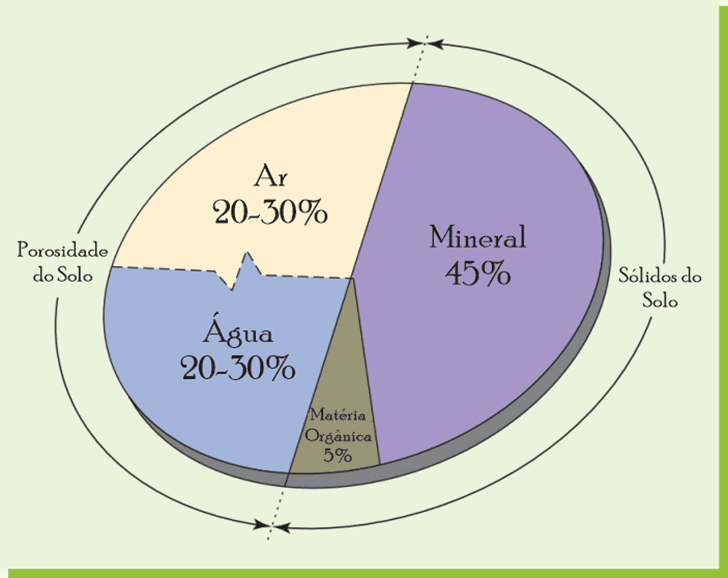{fig-align="center"}

## Importância mineral

::: {.fragment}

A fração mineral representa, em geral, mais de 90% da massa sólida da maioria dos solos.

Compreender a origem e a natureza desses minerais é essencial para entender a fertilidade, 
a física e a química do solo.

:::

::: {.incremental}

- Determinam a textura e a estrutura do solo;
- Controlam a Capacidade de Troca Catiônica (CTC);
- Regulam a disponibilidade de nutrientes;
- Influenciam a cor, a retenção de água e o comportamento físico;
- Orientam decisões de manejo, calagem e adubação.

:::

## A fração mineral do solo

::: {.columns}

::: {.column}

::: {.fragment}

**Minerais primários**

- Herdados diretamente da rocha-mãe;
- Não sofreram alteração química significativa;
- Predominam nas frações areia e silte.

:::

:::

::: {.column}

::: {.fragment}

**Minerais secundários**

- Formados no próprio solo;
- Resultam do intemperismo dos primários;
- Predominam na fração argila.

:::

:::

:::

## A fração mineral do solo

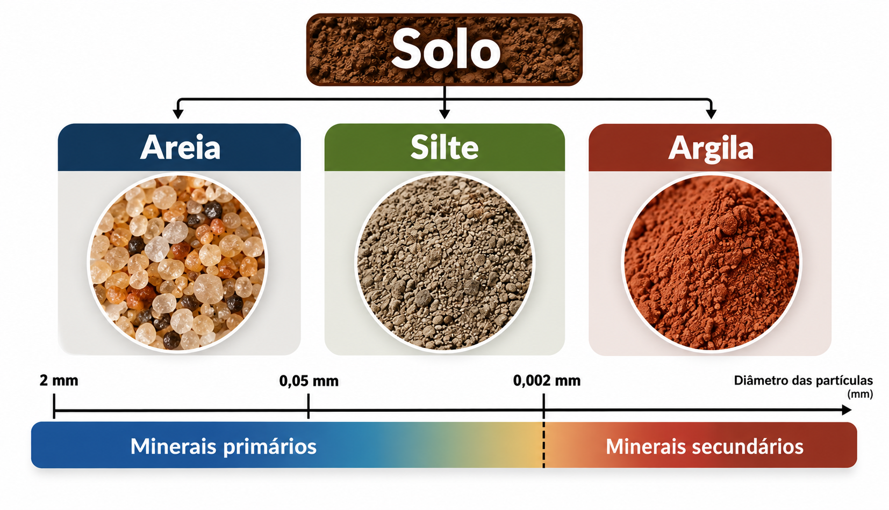{fig-align="center"}

## Composição da crosta terrestre

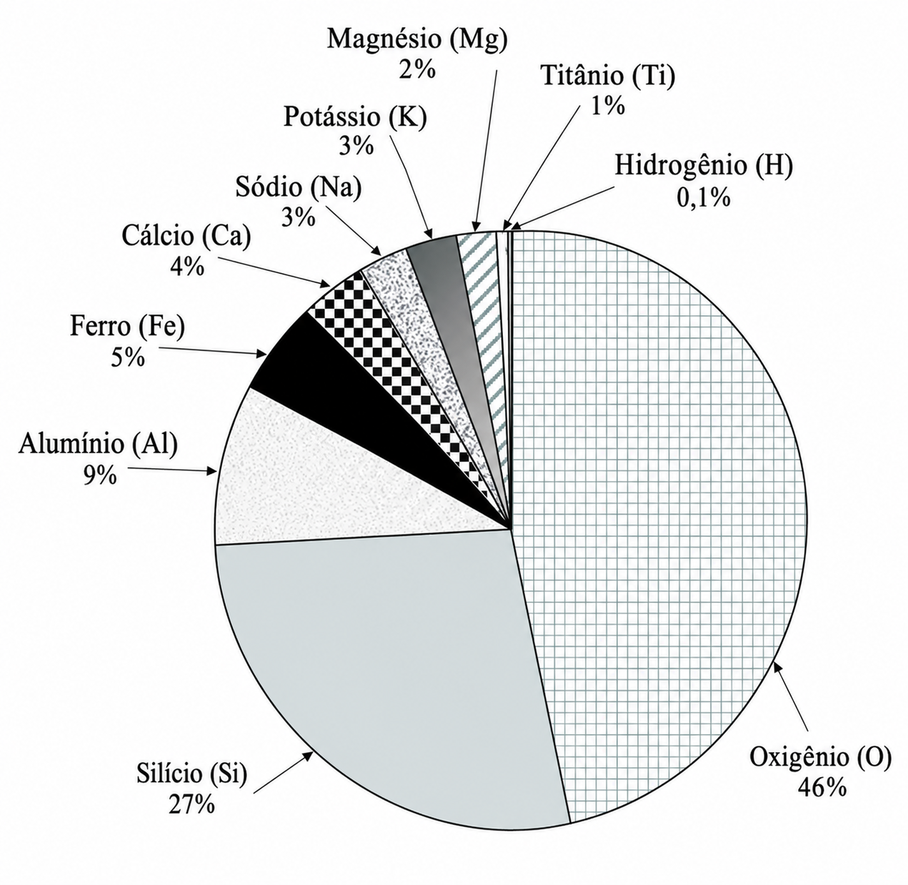{fig-align="center"}

## Minerais primários x minerais secundários

| **Característica** | **Minerais primários** | **Minerais secundários** |
|:---|:---|:---|
| Origem | Rocha-mãe (magmática, metamórfica) | Intemperismo dos primários |
| Localização no solo | Frações areia e silte | Fração argila |
| Estabilidade | Variável (função da estrutura cristalina) | Mais estáveis nas condições de superfície |
| Exemplo | Quartzo, feldspato, mica | Caulinita, esmectita, óxidos de Fe/Al |

## Intemperismo de minerais primários

::: {.fragment}

O intemperismo físico fragmenta a rocha, aumentando a superfície de contato.

:::

::: {.fragment}

O intemperismo químico (hidrólise, oxidação, dissolução, hidratação) altera a estrutura cristalina dos minerais primários.

:::

::: {.fragment}

Como resultado, íons são liberados para a solução do solo e novos minerais são formados (secundários).

:::

# Principais classes de minerais

## Principais classes de minerais

Os minerais são divididos em classes de acordo com o ânion ou grupo aniônico dominante

e subdivididos com base na estrutura química e nas semelhanças entre eles.

::: {.columns}

::: {.column}

::: {.incremental}

- Elementos nativos:
  - Ouro (Au), cobre (Cu), enxofre (S);
- Sulfetos;
- Sulfossais;
- Óxidos, hidróxidos e oxihidróxidos;
- Haletos;

:::

:::

::: {.column}

::: {.incremental}

- Carbonatos;
- Nitratos;
- Boratos;
- Fosfatos;
- Sulfatos;
- Tungstatos;
- Silicatos.

:::

:::

:::

# Minerais Primários

## Minerais Primários

São minerais **herdados** da rocha de origem, presentes no solo sem alteração relevante em sua composição e estrutura cristalina.

::: {.fragment}

Concentram-se principalmente nas frações **areia** e **silte**.

:::

::: {.fragment}

Constituem a principal **reserva de nutrientes** de longo prazo do solo.

:::

## Origem e ocorrência

::: {.incremental}

- Cristalizam-se a partir do magma (rochas ígneas);
- Podem também ser herdados de rochas metamórficas e sedimentares;
- São transportados por processos geológicos e incorporados ao material de origem do solo;
- Sua abundância relativa reflete a composição da rocha-mãe.

:::

## Quartzo (SiO2)

::: {.incremental}

- Silicato mais simples: tetraedros de SiO4 unidos em rede tridimensional;
- Não possui cátions substituíveis na estrutura;
- É o mineral mais abundante na fração areia da maioria dos solos.

:::

::: {.fragment}

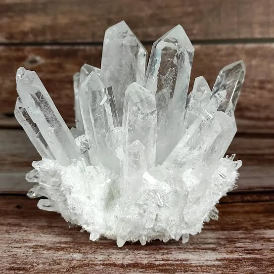{fig-align="center" width="420px"}

:::

## Quartzo  (SiO2) 

[__Propriedades e resistência ao intemperismo:__]{.fg style="--col: #e64173"}

::: {.fragment}

Estrutura extremamente estável, com ligações Si–O fortes e sem planos de clivagem fáceis.

:::

::: {.fragment}

Por isso, é o mineral primário **mais resistente** ao intemperismo químico, acumulando-se residualmente no solo.

:::

## Quartzo  (SiO2) 

[__Importância no solo:__]{.fg style="--col: #e64173"}

::: {.incremental}

- Define grande parte da textura arenosa dos solos;
- Contribui pouco para a fertilidade química (praticamente inerte);
- Influencia positivamente a drenagem e a aeração;
- Tem baixa capacidade de retenção de água e nutrientes.

:::

## Quartzo  (SiO2) 

 <iframe title="Crystal structure of low-Quartz {222}" frameborder="0" allowfullscreen mozallowfullscreen="true" webkitallowfullscreen="true" allow="autoplay; fullscreen; xr-spatial-tracking" xr-spatial-tracking execution-while-out-of-viewport execution-while-not-rendered web-share  width="900" height="600" src="https://sketchfab.com/models/99491b3dd2c747a184ae39d945231e61/embed"> </iframe> 
 <a href="https://sketchfab.com/3d-models/crystal-structure-of-low-quartz-222-99491b3dd2c747a184ae39d945231e61" target="_blank" rel="nofollow" style="font-weight: bold; color: #1CAAD9;"> Crystal structure of low-Quartz {222} </a> by <a href="https://sketchfab.com/MineralogyPetrographyMuseum" target="_blank" rel="nofollow" style="font-weight: bold; color: #1CAAD9;"> Museum of Mineralogy and Petrography, UAIC </a> on <a href="https://sketchfab.com" target="_blank" rel="nofollow" style="font-weight: bold; color: #1CAAD9;">Sketchfab</a>

## Feldspatos 

::: {.fragment}

Os feldspatos são os minerais mais abundantes da crosta terrestre.

:::

::: {.fragment}

Dividem-se principalmente em **feldspatos potássicos** e **plagioclásios**.

:::

::: {.fragment}

São tectossilicatos, com parte do Si substituída por Al na estrutura, o que gera carga negativa balanceada por cátions (K, Na, Ca).

:::

## Feldspato potássico

::: {.incremental}

- O ortoclásio é o principal representante;
- Fórmula geral: KAlSi3O8;
- Intemperiza mais lentamente que os plagioclásios;
- Importante fonte primária de **potássio** para o solo.

:::

::: {.fragment}

::: {layout-nrow=1}

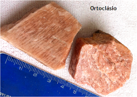{fig-align="center" width="450px"}

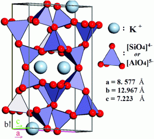{fig-align="center" width="400px"}

:::
:::

## Feldspato potássico

Hidrólise do ortoclásio, com formação de caulinita:

$$2\,\text{KAlSi}_3\text{O}_8 + 2\,\text{H}^+ + 9\,\text{H}_2\text{O} \;\longrightarrow\; \text{Al}_2\text{Si}_2\text{O}_5(\text{OH})_4 + 4\,\text{H}_4\text{SiO}_4 + 2\,\text{K}^+$$

::: {.fragment}

(ortoclásio) → (caulinita) + sílica dissolvida + **K+ liberado à solução do solo**

:::

## Plagioclásios

::: {.incremental}

- Série isomórfica contínua entre albita (NaAlSi3O8) e anortita (CaAl2Si2O8);
- Quanto mais cálcicos, mais rapidamente intemperizam;
- Liberam **cálcio, sódio, silício e alumínio** ao solo.

:::

::: {.fragment}

::: {layout-nrow=1}

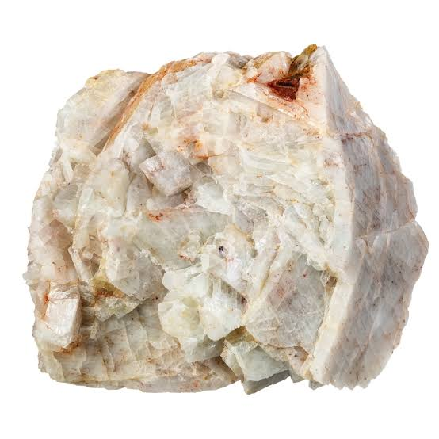{fig-align="center" width="400px"}

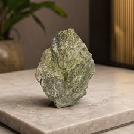{fig-align="center" width="370px"}

:::

:::

## Micas

::: {.incremental}

- Filossilicatos (estrutura em folhas);
- Apresentam clivagem perfeita em uma direção (lâminas);
- Os dois principais representantes de interesse agronômico são a **muscovita** e a **biotita**.

:::

::: {.fragment}

Tetraedros e octaedros

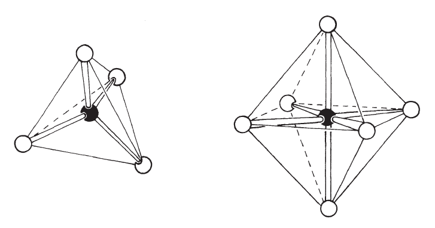{fig-align="center" width="550px"}

:::

## Micas

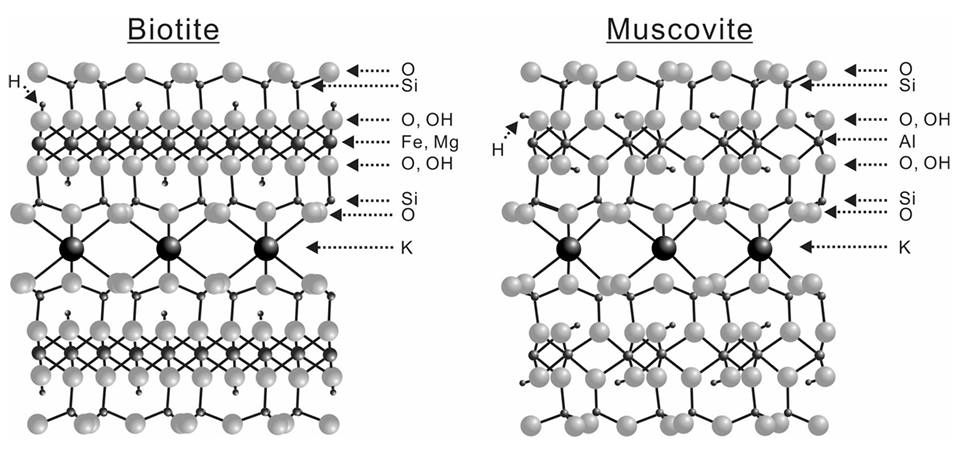{fig-align="center" width="600px"}

## Muscovita

::: {.incremental}

- Mica clara (branca), rica em K e Al;
- Fórmula geral: KAl2(AlSi3O10)(OH)2;
- Relativamente resistente ao intemperismo;
- Fonte de **potássio** de liberação lenta.

:::

## Muscovita

 <iframe title="Crystal structure of Muscovite" frameborder="0" allowfullscreen mozallowfullscreen="true" webkitallowfullscreen="true" allow="autoplay; fullscreen; xr-spatial-tracking" xr-spatial-tracking execution-while-out-of-viewport execution-while-not-rendered web-share  width="900" height="600" src="https://sketchfab.com/models/1e1ed07cdd5b4617b7611379655ee569/embed"> </iframe> 
 <a href="https://sketchfab.com/3d-models/crystal-structure-of-muscovite-1e1ed07cdd5b4617b7611379655ee569" target="_blank" rel="nofollow" style="font-weight: bold; color: #1CAAD9;"> Crystal structure of Muscovite </a> by <a href="https://sketchfab.com/MineralogyPetrographyMuseum" target="_blank" rel="nofollow" style="font-weight: bold; color: #1CAAD9;"> Museum of Mineralogy and Petrography, UAIC </a> on <a href="https://sketchfab.com" target="_blank" rel="nofollow" style="font-weight: bold; color: #1CAAD9;">Sketchfab</a>

## Biotita

::: {.incremental}

- Mica escura, rica em Fe e Mg (além de K e Al);
- Intemperiza mais rapidamente que a muscovita;
- Libera **K, Mg e Fe** ao ser alterada;
- Origina vermiculita e esmectita por transformação.

:::

## Piroxênios

::: {.incremental}

- Inossilicatos de cadeia simples (tetraedros unidos em cadeia única);
- Ricos em Ca, Mg e Fe;
- Exemplo mais comum: augita.
  - Comuns em rochas basálticas;
  - Intemperizam com relativa rapidez;
  - Liberam **Ca, Mg, Fe e Si**, contribuindo para solos mais férteis (ex.: derivados de basalto).

:::

## Anfibólios

::: {.incremental}

- Inossilicatos de cadeia dupla;
- Estrutura mais complexa que a dos piroxênios;
- Também ricos em Ca, Mg e Fe, além de conterem OH na estrutura;
- A hornblenda é o representante mais comum;
- Intemperismo relativamente rápido;
- Contribuem com **Ca, Mg e Fe** para a solução do solo.

:::

## Equação geral da hidrólise dos silicatos

De forma geral, o intemperismo químico de um silicato primário pode ser representado por:

$$
\text{Silicato} + n\mathrm{H^+} + m\mathrm{H_2O}
\rightarrow
\text{cátions}_{(aq)} + x\mathrm{H_4SiO_4} + \text{argilomineral}
$$

::: {.fragment}

Ou seja: **hidrólise ácida** → liberação de cátions e sílica em solução → (re)precipitação de um novo mineral.

:::

# Minerais Secundários

## Minerais Secundários

São minerais **formados no próprio solo**, a partir da alteração dos minerais primários.

::: {.fragment}

Predominam na fração **argila** e são responsáveis pela maior parte da atividade química do solo.

:::

## Formação: transformação x neoformação

::: {.columns}

::: {.column}

**Transformação**

- O mineral secundário herda parte da estrutura do mineral primário;
- Ex.: mica → ilita → vermiculita.

:::

::: {.column}

**Neoformação**

- O mineral se origina a partir de elementos liberados na solução do solo;
- Ex.: dissolução total seguida de recristalização de novos minerais.

:::

:::

## Estrutura geral dos argilominerais — folha tetraédrica

::: {.incremental}

- Unidade básica: tetraedro de Si (ou Al) coordenado por 4 oxigênios;
- Os tetraedros se unem pelos vértices, formando uma folha hexagonal contínua;
- É a mesma unidade estrutural presente nos silicatos primários.

:::

## Estrutura geral dos argilominerais — folha octaédrica

::: {.incremental}

- Unidade básica: cátion (Al3+, Mg2+, Fe3+) coordenado por 6 oxigênios/hidroxilas;
- Formam folhas octaédricas do tipo gibbsita (dioctaédrica, Al) ou brucita (trioctaédrica, Mg);
- A combinação de folhas tetraédricas e octaédricas origina os diferentes argilominerais.

:::

## Estrutura geral dos argilominerais

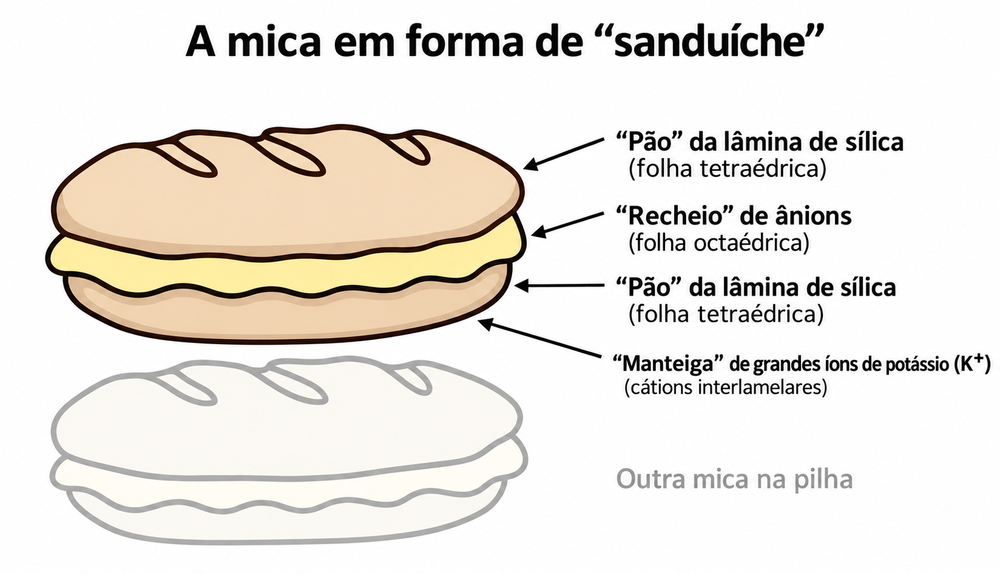{fig-align="center"}

## Estrutura geral dos argilominerais

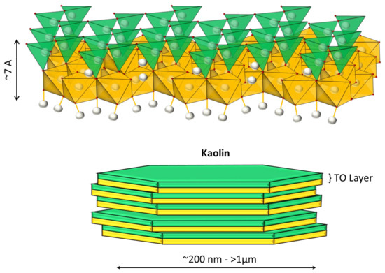{fig-align="center"}

## Camadas 1:1, 2:1 e 2:1:1

| **Tipo de camada** | **Composição** | **Exemplo** |
|:---|:---|:---|
| 1:1 | 1 folha tetraédrica + 1 folha octaédrica | Caulinita |
| 2:1 | 2 folhas tetraédricas + 1 folha octaédrica | Ilita, esmectita, vermiculita |
| 2:1:1 | 2:1 + folha octaédrica adicional (interlamelar) | Clorita |

## Substituição isomórfica e origem da carga elétrica

::: {.fragment}

Ocorre quando um cátion de menor carga substitui outro na estrutura (ex.: Al3+ por Si4+; Mg2+ por Al3+), sem alterar a estrutura cristalina.

:::

::: {.fragment}

Gera **carga negativa permanente**, responsável por grande parte da CTC dos argilominerais 2:1.

:::

## Grupo da Caulinita — estrutura 1:1

::: {.incremental}

- Camada 1:1 fortemente ligada por pontes de hidrogênio entre camadas adjacentes;
- Pouquíssima substituição isomórfica;
- Argilomineral mais comum em solos tropicais muito intemperizados.

:::

## Grupo da Caulinita — estrutura 1:1

 <iframe title="Crystal structure of Kaolinite" frameborder="0" allowfullscreen mozallowfullscreen="true" webkitallowfullscreen="true" allow="autoplay; fullscreen; xr-spatial-tracking" xr-spatial-tracking execution-while-out-of-viewport execution-while-not-rendered web-share width="900" height="600"  src="https://sketchfab.com/models/7065767c9a7540c6bc015e2a85e34bbc/embed"> </iframe> 
 <a href="https://sketchfab.com/3d-models/crystal-structure-of-kaolinite-7065767c9a7540c6bc015e2a85e34bbc" target="_blank" rel="nofollow" style="font-weight: bold; color: #1CAAD9;"> Crystal structure of Kaolinite </a> by <a href="https://sketchfab.com/MineralogyPetrographyMuseum" target="_blank" rel="nofollow" style="font-weight: bold; color: #1CAAD9;"> Museum of Mineralogy and Petrography, UAIC </a> on <a href="https://sketchfab.com" target="_blank" rel="nofollow" style="font-weight: bold; color: #1CAAD9;">Sketchfab</a>

## Caulinita — propriedades

::: {.incremental}

- Baixa CTC (cerca de 3 a 15 cmolc/kg);
- Baixa superfície específica;
- Não expansiva (não incha com água);
- Baixa plasticidade e coesão em relação às argilas 2:1.

:::

## Caulinita — ocorrência

::: {.fragment}

Predomina em solos altamente intemperizados de regiões tropicais e subtropicais, como os **Latossolos** brasileiros.

:::

::: {.fragment}

Reflete estágio avançado de intemperismo, com perda quase completa de sílica e bases trocáveis.

:::

## Caulinita → Gibbsita — equação de dessilicificação

Em condições de intemperismo extremo (alta lixiviação de sílica), a caulinita pode se alterar para gibbsita:

$$\text{Al}_2\text{Si}_2\text{O}_5(\text{OH})_4 + 5\,\text{H}_2\text{O} \;\longrightarrow\; 2\,\text{Al(OH)}_3 + 2\,\text{H}_4\text{SiO}_4$$

::: {.fragment}

Etapa final da **dessilicificação**: perda quase total de Si, restando óxido/hidróxido de Al — marca dos Latossolos mais intemperizados.

:::

## Grupo das Ilitas (micas hidratadas)

::: {.incremental}

- Estrutura 2:1, derivada diretamente da mica por perda parcial de K;
- Camada com carga negativa relativamente alta, parcialmente satisfeita por K interlamelar;
- CTC intermediária (cerca de 15 a 40 cmolc/kg).

:::

## Ilita — propriedades e ocorrência

::: {.incremental}

- Fonte importante de **potássio** de liberação lenta;
- Comum em solos jovens a moderadamente intemperizados;
- Frequente em sedimentos e solos de regiões temperadas.

:::

## Grupo dos filossilicatos expansivos

::: {.incremental}

- Estrutura 2:1 com fraca ligação entre camadas;
- Alta substituição isomórfica, gerando elevada carga negativa;
- Água e cátions entram facilmente no espaço interlamelar.

:::

## Esmectita

 <iframe title="Crystal structure of Smectites" frameborder="0" allowfullscreen mozallowfullscreen="true" webkitallowfullscreen="true" allow="autoplay; fullscreen; xr-spatial-tracking" xr-spatial-tracking execution-while-out-of-viewport execution-while-not-rendered web-share  width="900" height="600" src="https://sketchfab.com/models/3a0a316ef02c40fea71f4124bf76c0e5/embed"> </iframe> 
 <a href="https://sketchfab.com/3d-models/crystal-structure-of-smectites-3a0a316ef02c40fea71f4124bf76c0e5" target="_blank" rel="nofollow" style="font-weight: bold; color: #1CAAD9;"> Crystal structure of Smectites </a> by <a href="https://sketchfab.com/MineralogyPetrographyMuseum" target="_blank" rel="nofollow" style="font-weight: bold; color: #1CAAD9;"> Museum of Mineralogy and Petrography, UAIC </a> on <a href="https://sketchfab.com" target="_blank" rel="nofollow" style="font-weight: bold; color: #1CAAD9;">Sketchfab</a>

## Esmectita — propriedades

::: {.incremental}

- CTC muito alta (60 a 150 cmolc/kg);
- Alta superfície específica;
- Mineral **expansivo**: incha ao umedecer e contrai ao secar;
- Alta plasticidade e pegajosidade.

:::

## Esmectita — ocorrência e manejo

::: {.fragment}

Comum em solos pouco intemperizados, derivados de rochas básicas (ex.: basalto) em climas com estação seca definida — **Vertissolos**.

:::

::: {.fragment}

A expansão e a contração causam fendilhamento do solo, dificultando o manejo mecânico e podendo danificar raízes e estruturas.

:::

## Vermiculita — estrutura e propriedades

::: {.incremental}

- Estrutura 2:1, geralmente originada da alteração da biotita;
- Carga negativa alta, parcialmente ocupada por Mg e água interlamelar;
- CTC alta (100 a 150 cmolc/kg);
- Expansão moderada (menor que a da esmectita).

:::

## Vermiculita — ocorrência no solo

::: {.fragment}

Mineral de transição entre a mica primária e argilominerais mais intemperizados.

:::

::: {.fragment}

Comum em solos de regiões temperadas e em horizontes pouco profundos de solos tropicais jovens.

:::

## 1:1 vs 2:1

::: {.fragment}

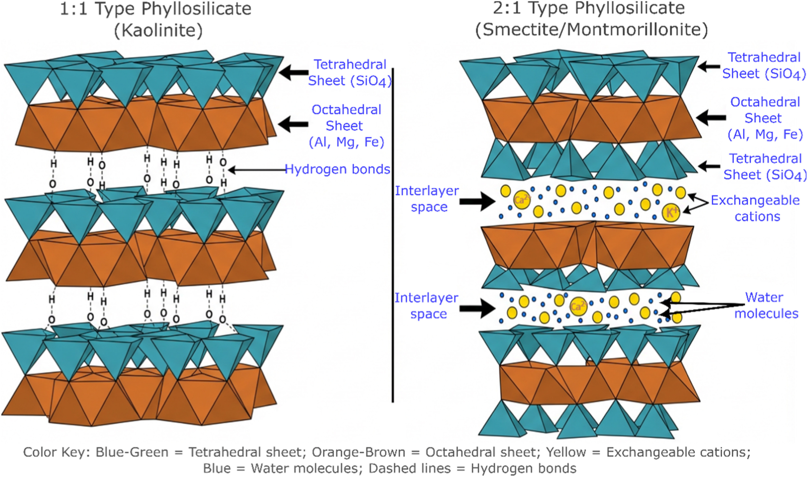{fig-align="center"}

:::

## Óxidos e hidróxidos de ferro

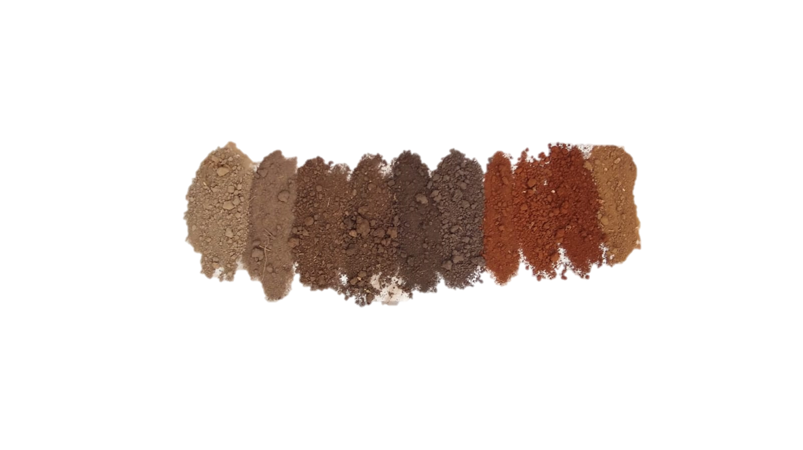{fig-align="center" width="650"}

## Óxidos e hidróxidos de ferro — hematita

::: {.incremental}

- Fe2O3; forma cristalina bem ordenada;
- Confere coloração **vermelha** característica ao solo;
- Comum em solos bem drenados e intemperizados de clima tropical.

:::

::: {.fragment}

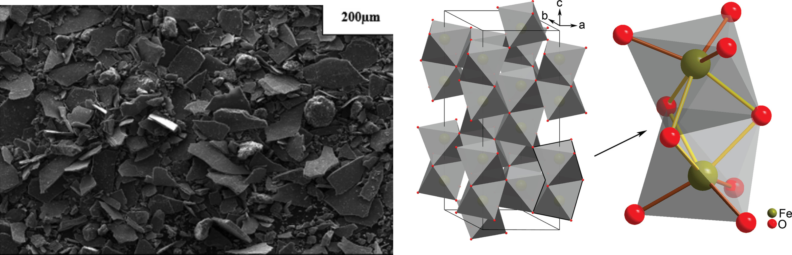{fig-align="center" width="950px"}

:::

## Óxidos e hidróxidos de ferro — hematita

 <iframe title="Crystal structure of Hematite" frameborder="0" allowfullscreen mozallowfullscreen="true" webkitallowfullscreen="true" allow="autoplay; fullscreen; xr-spatial-tracking" xr-spatial-tracking execution-while-out-of-viewport execution-while-not-rendered web-share width="900" height="600"  src="https://sketchfab.com/models/3b51abc1b7f64b438a8008831316555f/embed"> </iframe> 
 <a href="https://sketchfab.com/3d-models/crystal-structure-of-hematite-3b51abc1b7f64b438a8008831316555f" target="_blank" rel="nofollow" style="font-weight: bold; color: #1CAAD9;"> Crystal structure of Hematite </a> by <a href="https://sketchfab.com/MineralogyPetrographyMuseum" target="_blank" rel="nofollow" style="font-weight: bold; color: #1CAAD9;"> Museum of Mineralogy and Petrography, UAIC </a> on <a href="https://sketchfab.com" target="_blank" rel="nofollow" style="font-weight: bold; color: #1CAAD9;">Sketchfab</a>

## Óxidos e hidróxidos de ferro — goethita

::: {.incremental}

- FeOOH; mineral de ferro mais comum nos solos em geral;
- Confere coloração **amarela/amarelo-brunada**;
- Estável em ampla faixa de condições, inclusive climas úmidos e frios.

:::

::: {.fragment}

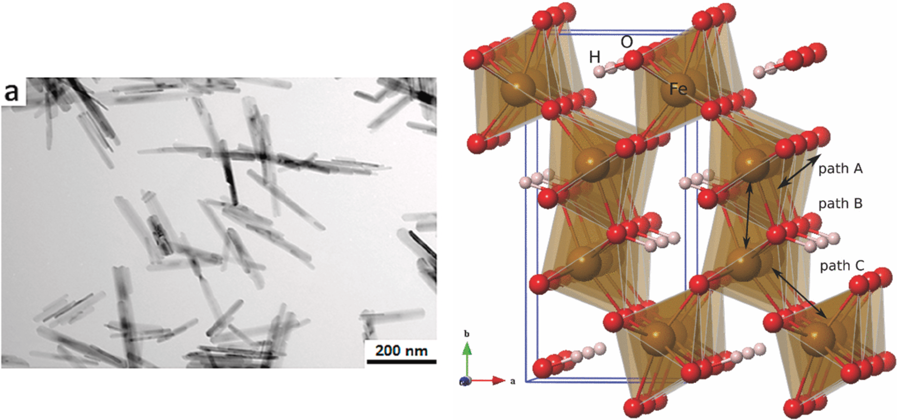{fig-align="center" width="850px"}

:::

## Goethita ⇌ Hematita — equação de desidratação

$$2\,\text{FeOOH} \;\rightleftharpoons\; \text{Fe}_2\text{O}_3 + \text{H}_2\text{O}$$

::: {.fragment}

Climas mais quentes e secos favorecem a hematita (desidratação); climas mais úmidos e frios favorecem a goethita — por isso a cor do solo é um indicador climático e mineralógico.

:::

## Óxidos de ferro 

::: {layout-nrow=1}

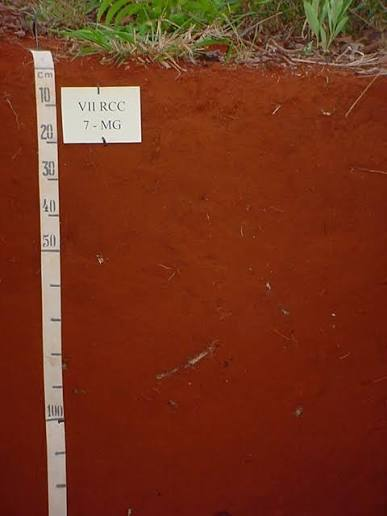{fig-align="center"}

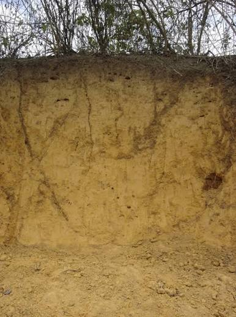{fig-align="center" width="400px"}

:::

## Óxidos de ferro — importância

::: {.fragment}

Além de definirem a [cor do solo](https://fgu5tav0.github.io/OxSR/), os óxidos de Fe atuam como agentes cimentantes de agregados e possuem carga variável, dependente do pH.

:::

::: {.fragment}

São importantes adsorventes de fósforo e de alguns micronutrientes.

:::

## Outros óxidos de ferro

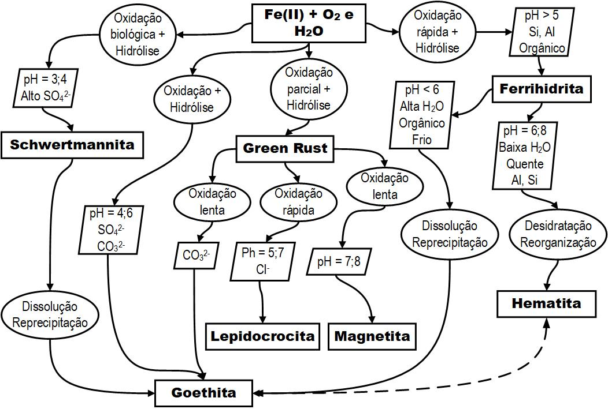{fig-align="center"}

## Óxidos e hidróxidos de alumínio — gibbsita

::: {.incremental}

- Al(OH)3; forma-se em estágios avançados de intemperismo (dessilicificação);
- Comum em Latossolos muito intemperizados;
- Possui carga variável, dependente do pH do meio.

:::

## Carga variável x carga permanente

| **Tipo de carga** | **Origem** | **Minerais** |
|:---|:---|:---|
| Permanente | Substituição isomórfica na estrutura | Argilominerais 2:1 (esmectita, vermiculita, ilita) |
| Variável | Dissociação de grupos OH na superfície, dependente do pH | Óxidos e hidróxidos de Fe e Al, caulinita (bordas) |

## Minerais amorfos e de baixa cristalinidade

::: {.incremental}

- Alofana e imogolita: aluminossilicatos de baixa ordem cristalina;
- Alta superfície específica e alta capacidade de retenção de água e P;
- Formam-se rapidamente a partir de material vulcânico.

:::

## Sequência de intemperismo e neoformação mineral

::: {.fragment}

De modo geral, a sequência de estágios de intemperismo segue:

:::

::: {.fragment}

Minerais primários facilmente intemperizáveis → argilominerais 2:1 → argilominerais 1:1 (caulinita) → óxidos de Fe e Al.

:::

::: {.fragment}

Essa sequência reflete a perda progressiva de sílica e de bases trocáveis ao longo do tempo.

:::

## Distribuição dos argilominerais: solos tropicais x temperados

| **Ambiente** | **Mineralogia predominante** | **Exemplo de solo** |
|:---|:---|:---|
| Tropical, muito intemperizado | Caulinita, óxidos de Fe/Al | Latossolos |
| Tropical, pouco intemperizado (rocha básica, clima sazonal) | Esmectita | Vertissolos |
| Temperado / jovem | Ilita, vermiculita, clorita | Solos de regiões temperadas |

## Transformação e neoformação de minerais no solo

| **Mineral primário — Rocha** | **Elementos liberados** | **Minerais secundários — Solo** |
|:-----------------------------|:-------------------------|:--------------------------------|
| Quartzo                      | Si                       | Caulinita, sílica amorfa        |
| Feldspato potássico          | K, Si, Al                | Caulinita, ilita                |
| Plagioclásio                 | Ca, Na, Si, Al           | Caulinita, esmectita            |
| Biotita                      | K, Mg, Fe, Si            | Vermiculita, esmectita, clorita |
| Muscovita                    | K, Al, Si                | Ilita, vermiculita              |
| Piroxênio                    | Ca, Mg, Fe, Si           | Esmectita, óxidos de Fe         |
| Anfibólio                    | Ca, Mg, Fe, Si           | Esmectita, clorita, óxidos de Fe|
| Olivina                      | Mg, Fe, Si               | Esmectita, óxidos de Fe         |
| Apatita                      | Ca, P                    | Fosfatos secundários            |
| Magnetita                    | Fe                       | Hematita, goethita              |

# Importância Agronômica dos Minerais do Solo

## Importância agronômica dos minerais do solo

A mineralogia do solo não é apenas uma questão descritiva: ela **condiciona diretamente** o manejo, a fertilidade e o potencial produtivo.

::: {.fragment}

A seguir, veremos as principais implicações agronômicas da mineralogia primária e secundária.

:::

## Capacidade de troca catiônica (CTC) e mineralogia

::: {.incremental}

- A CTC depende diretamente do tipo e da quantidade de argilominerais presentes;
- Argilas 2:1 (esmectita, vermiculita) apresentam CTC muito maior que argilas 1:1 (caulinita);
- Óxidos de Fe e Al contribuem pouco para a CTC em pH próximo à neutralidade.

:::

## CTC — argilas 1:1 x 2:1

| **Mineral** | **CTC (cmolc/kg)** | **Superfície específica** |
|:---|:---|:---|
| Caulinita | 3–15 | Baixa |
| Ilita | 15–40 | Média |
| Vermiculita | 115–250 | Muito alta |
| Esmectita | 50–160 | Alta |

## Retenção e disponibilidade de água

::: {.incremental}

- Argilas 2:1 e minerais amorfos retêm muito mais água que a caulinita e a areia;
- Solos cauliníticos drenam mais rápido, mas têm menor reserva hídrica;
- A mineralogia influencia diretamente o manejo da irrigação.

:::

## Estrutura e agregação do solo

::: {.fragment}

Óxidos de Fe e Al atuam como agentes cimentantes, favorecendo agregados estáveis em Latossolos.

:::

::: {.fragment}

Argilas esmectíticas, por expandirem e contraírem, podem tanto formar quanto destruir agregados, dependendo do teor de sódio e da umidade.

:::

## Fixação de fósforo pelos óxidos de Fe e Al

::: {.incremental}

- Óxidos de Fe e Al possuem forte afinidade química pelo fosfato;
- Em solos ricos nesses óxidos (ex.: Latossolos), grande parte do P aplicado é adsorvida e torna-se pouco disponível;
- Exige manejo específico da adubação fosfatada (fosfatagem corretiva, adubação localizada).

:::

## Fixação de fósforo pelos óxidos de Fe e Al

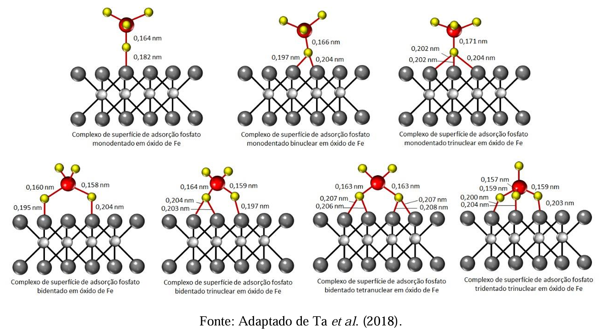{fig-align="center"}

## Fixação de fósforo pelos óxidos de Fe e Al

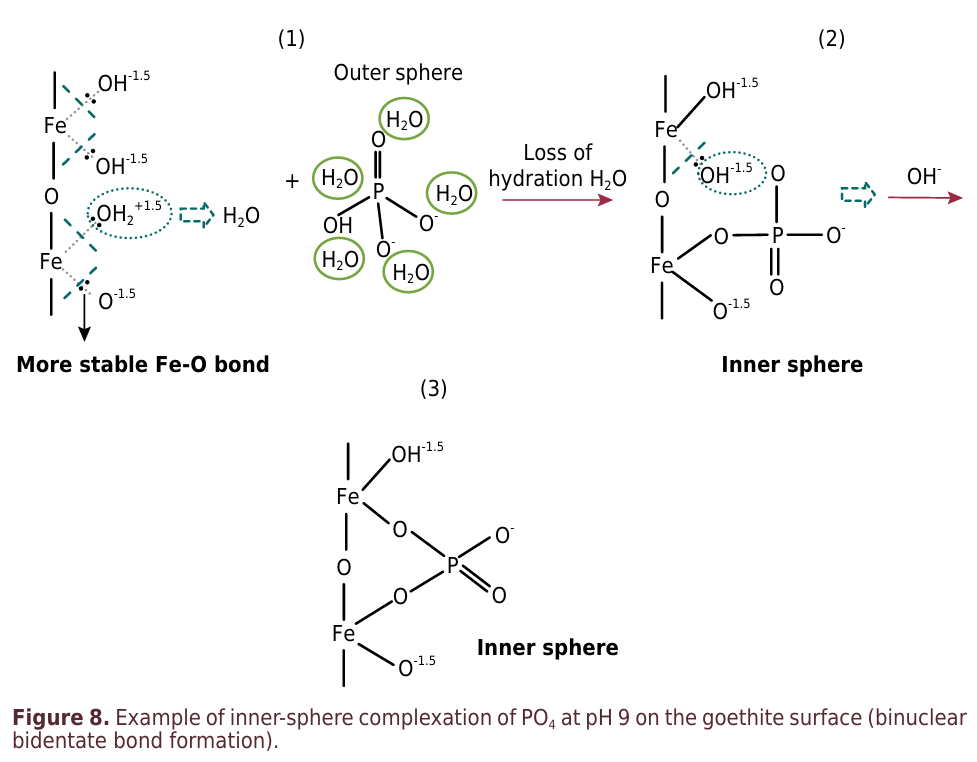{fig-align="center"}

## Disponibilidade de potássio — micas e feldspatos

::: {.incremental}

- Micas e feldspatos potássicos são fontes naturais de K de liberação lenta;
- Solos derivados desses minerais tendem a manter suprimento contínuo de K ao longo do tempo;
- Solos muito intemperizados (pobres nesses minerais) dependem mais de adubação potássica.

:::

## Disponibilidade de potássio — micas

::: {.fragment}

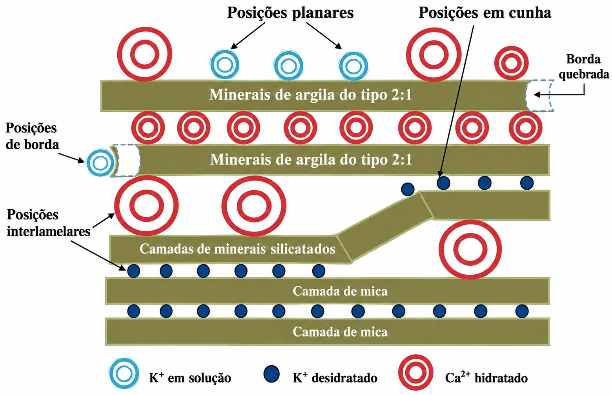{fig-align="center" width="850px"}

:::

## pH do solo e reatividade dos óxidos

::: {.fragment}

Óxidos de Fe e Al apresentam **carga variável**, dependente do pH — carga positiva em pH baixo, negativa em pH alto.

:::

::: {.fragment}

O **ponto de carga zero (PCZ)** desses minerais explica por que solos oxídicos podem apresentar CTC efetiva muito baixa em pH ácido.

:::

## Cor do solo como indicador mineralógico

::: {.incremental}

- Hematita → cores avermelhadas (bom indicador de boa drenagem);
- Goethita → cores amarelo-brunadas;
- Cores acinzentadas/esverdeadas indicam condições de redução (excesso de água, baixo O2);
- A cor é uma ferramenta prática de campo para inferir mineralogia e drenagem.

:::

## Mineralogia e classificação de solos

| **Classe de solo** | **Mineralogia típica** | **Implicação agronômica** |
|:---|:---|:---|
| Latossolos | Caulinita + óxidos de Fe/Al | Alta fixação de P, boa estrutura, baixa CTC |
| Argissolos | Caulinita, misto | Fertilidade intermediária |
| Vertissolos | Esmectita | Alta CTC, problemas físicos (fendilhamento) |
| Cambissolos/Neossolos | Minerais primários abundantes | Maior fertilidade natural, menor evolução |

## Mineralogia e manejo da adubação

::: {.incremental}

- Solos cauliníticos/oxídicos: adubação frequente e parcelada, atenção à fixação de P;
- Solos esmectíticos: cuidado com a sodicidade e o manejo físico, boa retenção de nutrientes;
- Solos ricos em minerais primários: aproveitar a liberação natural de nutrientes no planejamento da adubação.

:::

## Mineralogia e erosão / estabilidade de agregados

::: {.fragment}

A estabilidade dos agregados, fortemente ligada à presença de óxidos de Fe/Al, influencia diretamente a suscetibilidade do solo à erosão.

:::

::: {.fragment}

Solos com argilas expansivas e sem boa cimentação por óxidos tendem a ser mais suscetíveis à desagregação.

:::

## Micronutrientes e minerais primários residuais

::: {.incremental}

- Minerais primários acessórios (magnetita, ilmenita, apatita) também liberam micronutrientes (Fe, Mn, Zn, entre outros) durante o intemperismo;
- A ausência desses minerais em solos muito intemperizados pode gerar deficiências de micronutrientes.

:::

# Minerais no Brasil

## Minerais no Brasil

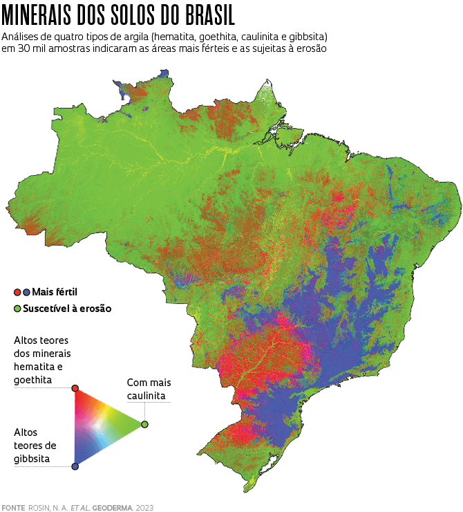{fig-align="center"}

# Identificação mineral

## Identificação mineral

Os raios X foram descobertos em novembro de 1895 pelo físico alemão Wilhelm Conrad Röntgen (1845–1923).

::: {.fragment layout-nrow=1}

{fig-align="center" width="450px"}

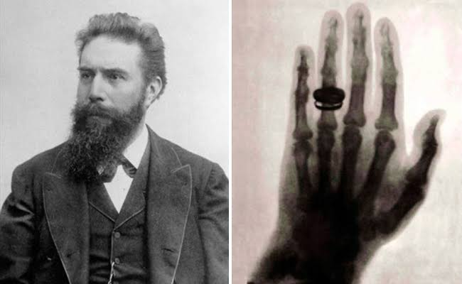{fig-align="center" width="600px"}

:::

## Identificação mineral

**Difração de raios X** e **Lei de Bragg**

Derivada pelos físicos ingleses Sir William Henry Bragg e William Lawrence Bragg, pai e filho, em 1913.

$$
\boxed{
n\lambda = 2d\sin(\theta)
}
$$

::: {style="font-size:24px"}

onde:

- $n$ — ordem de difração;
- $\lambda$ — comprimento de onda da radiação incidente;
- $d$ — distância interplanar dos planos cristalográficos;
- $\theta$ — ângulo de Bragg (ângulo de incidência em relação ao plano cristalográfico).

:::

## Identificação mineral - **Difração de raios X**

Preparo de amostras

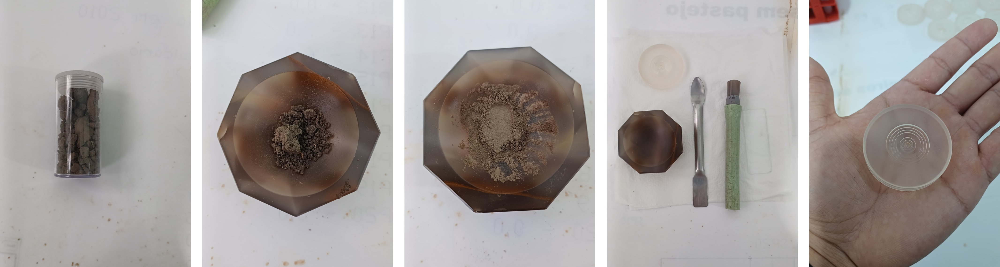{fig-align="center"}

## Identificação mineral - **Difração de raios X**

Preparo de amostras

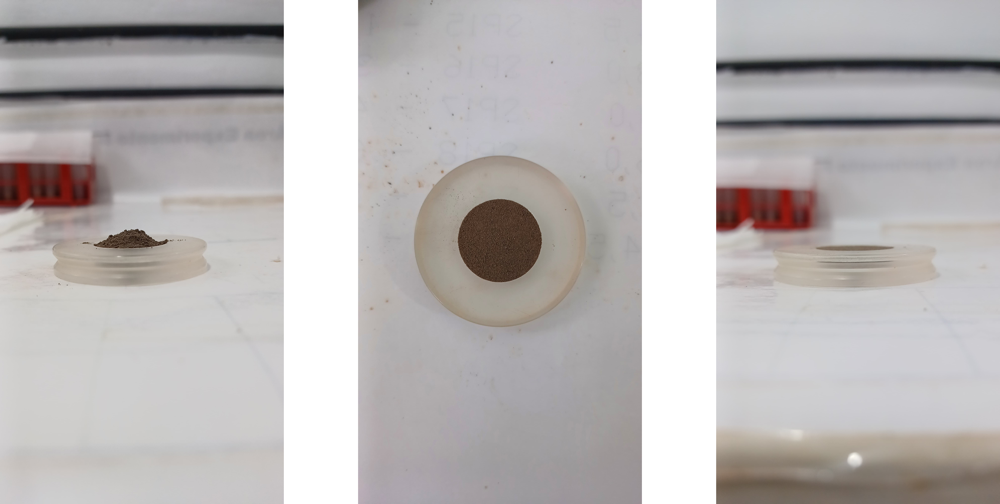{fig-align="center"}

## Identificação mineral - **Difração de raios X**

{fig-align="center" width="350px"}

## Identificação mineral - **Difração de raios X**

DRX caulinita

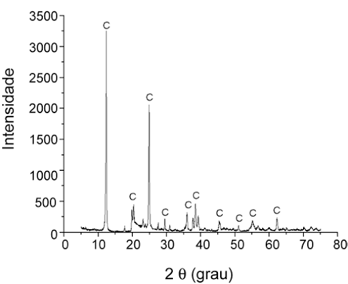{fig-align="center"}

## Identificação mineral - **Difração de raios X**

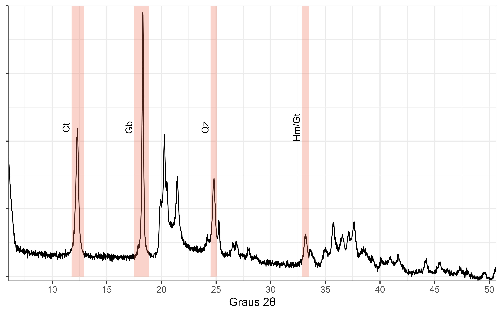{fig-align="center"}

# Fim!

