# Classificação taxonômica do solo

## Classificação taxonômica do solo

::: {.incremental}

- Atributos diagnósticos;
- Horizontes diagnósticos;
- Ordens de solos.

:::

## Classificação taxonômica do solo

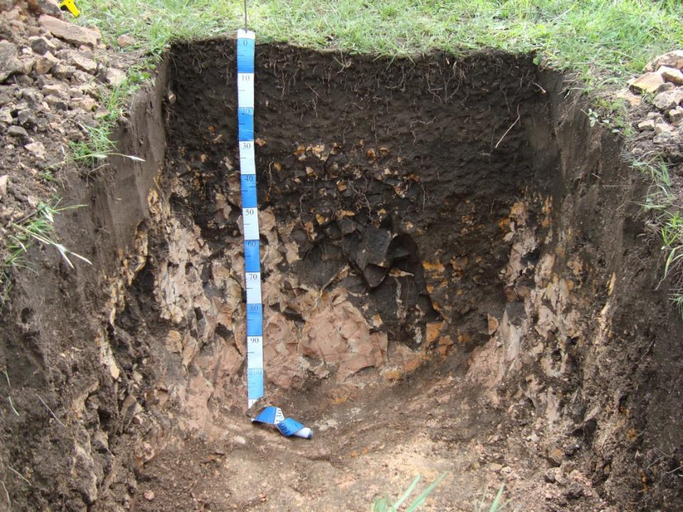{fig-align="center" width="700px"}

## Iniciando os trabalhos

[__Perfil do solo:__]{.fg style="--col: #e64173"}

volume tridimensional, menor unidade representativa das características do solo e sua variação.

::: {.fragment}

Profundidade de até 200 cm; 300 cm em caso de grande espessura do horizonte A; 400 cm em caso de grande espessura de horizontes A+E.

:::

::: {.incremental}

- Descrição morfológica completa do perfil do solo;
- Coleta de amostras;
- Análise e interpretação de atributos físicos, químicos e mineralógicos;
- **Classificação**: utilização de **atributos** e **horizontes diagnósticos**.

:::

## Materiais de consulta

::: {layout-nrow=1}

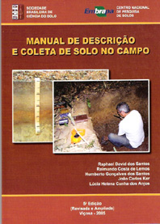{fig-align="center" height="450px"}

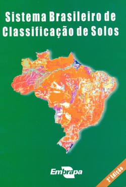{fig-align="center" height="450px"}

:::

## Análises químicas e físicas

::: {style="font-size:13px"}

| Perfil | Hz. | Calhaus | Cascalho | Terra fina | Areia grossa | Areia fina | Silte | Argila | Argila natural | GF | Silte/Argila |
|:--:|:--:|:--:|:--:|:--:|:--:|:--:|:--:|:--:|:--:|:--:|:--:|
|    |    | g kg^-1^ | g kg^-1^ | g kg^-1^ | g kg^-1^ | g kg^-1^ | g kg^-1^ | g kg^-1^ | % | % | |
| P1 | Ap  | 0   | 0   | 1000 | 250 | 513 | 130 | 107 | 27 | 75 | 1,21 |
|    | A   | 0   | 0   | 1000 | 194 | 533 | 135 | 140 | 34 | 76 | 0,96 |
|    | Cr1 | 603 | 306 | 91   | 163 | 542 | 134 | 161 | 35 | 78 | 0,83 |
|    | Cr2 | 930 | 60  | 10   | -   | -   | -   | -   | -  | -  | -    |
|    | RCr | 940 | 50  | 10   | -   | -   | -   | -   | -  | -  | -    |

:::

::: {style="font-size:13px"}

| Perfil | Hz. | pH H~2~O | pH KCl | ∆pH | Ca | Mg | Na | K | Al | H+Al | CTC | V (%) | m (%) | C~org~ (g kg^-1^) |
|:--:|:--:|:--:|:--:|:--:|:--:|:--:|:--:|:--:|:--:|:--:|:--:|:--:|:--:|:--:|
| P1 | Ap  | 4,60 | 3,15 | -1,46 | 1,44 | 0,20 | 0,27 | 0,25 | 3,22 | 13,69 | 15,85 | 13,6 | 59,85 | 11,0 |
|    | A   | 4,40 | 2,94 | -1,46 | 2,49 | 0,02 | 0,16 | 0,14 | 4,24 | 17,71 | 20,52 | 13,7 | 60,05 | 9,2  |
|    | Cr1 | 4,35 | 2,95 | -1,40 | 4,24 | 0,14 | 0,18 | 0,15 | 6,02 | 22,62 | 27,33 | 17,2 | 56,10 | 10,6 |

Ca, Mg, Na, K, Al, H+Al e CTC em cmol~c~ kg^-1^.

:::

# Atributos diagnósticos

## Material orgânico

::: {.columns}

::: {.column}

Constituintes orgânicos impõem preponderância de suas propriedades sobre os constituintes minerais.

O material do solo será considerado como orgânico quando, na TFSA:

::: {.fragment}

[__teor de C ≥ 80 g kg^-1^__]{.fg style="--col: #e64173"}

:::

:::

::: {.column}

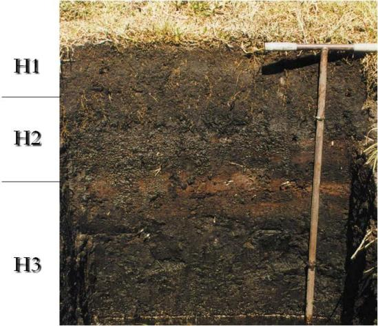{fig-align="center"}

:::

:::

## Material mineral

Formado, predominantemente, por compostos inorgânicos, em variáveis estágios de intemperismo.

O material do solo é considerado mineral quando não satisfizer os requisitos exigidos para material orgânico.

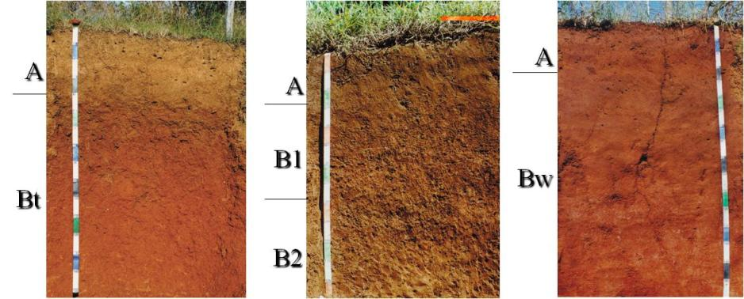{fig-align="center" width="700px"}

## Atividade da fração argila

Refere-se à capacidade de troca de cátions (CTC) da fração argila:

$$
T_{argila} = \frac{CTC}{g\ kg^{-1}\ argila} \times 1000
$$

::: {.incremental}

- **Atividade alta (Ta)**: > 27 cmol~c~ kg^-1^ de argila;
- **Atividade baixa (Tb)**: < 27 cmol~c~ kg^-1^ de argila.

:::

::: {.fragment}

> Característica avaliada no horizonte B ou no C, quando não existe o B.

:::

## Saturação por bases (valor V%)

Refere-se à proporção (%) de cátions básicos trocáveis em relação à CTC.

$$
V\% = \frac{S}{CTC} \times 100
$$

::: {.incremental}

- **Baixa saturação (distróficos)**: quando V < 50%;
- **Alta saturação (eutróficos)**: quando V ≥ 50%.

:::

::: {.fragment}

> Característica avaliada no horizonte B ou no C, quando não existe o B.

:::

## Caráter alumínico

Condição em que os materiais do solo se encontram em estado não saturado e com:

::: {.incremental}

- Teor de Al^3+^ extraível ≥ 4 cmol~c~ kg^-1^ de solo;
- Saturação com Al ≥ 50% e/ou saturação por bases < 50%;
- Associação com atividade de argila < 20 cmol~c~ kg^-1^.

:::

::: {.fragment}

> Característica avaliada no horizonte B.

:::

## Caráter alítico

Condição em que os materiais do solo se encontram em estado não saturado e com:

::: {.incremental}

- Teor de Al^3+^ extraível ≥ 4 cmol~c~ kg^-1^ de solo;
- Saturação com Al ≥ 50% e/ou saturação por bases < 50%;
- Associação com atividade de argila ≥ 20 cmol~c~ kg^-1^.

:::

::: {.fragment}

> Característica avaliada no horizonte B.

:::

## Caráter ácrico

Condição em que os materiais do solo contêm:

::: {.incremental}

- Al^3+^ extraível + bases trocáveis menor ou igual a 1,5 cmol~c~ kg^-1^ de argila; e
  - pH em KCl ≥ 5,0; ou
  - ∆pH (pH~KCl~ – pH~H2O~) positivo ou nulo.

:::

## Caráter sódico ou solódico

Quando horizontes ou camadas, na seção controle, apresentam saturação por Na^+^.

$$
\%Na = \frac{Na}{CTC_{pH7}} \times 100
$$

::: {.incremental}

- **Sódico**: %Na ≥ 15%;
- **Solódico**: %Na entre 6% e < 15%.

:::

## Caráter salino e sálico

::: {.columns}

::: {.column}

Presença de sais em quantidades que interferem no desenvolvimento da maioria das culturas (**salino**) ou em quantidades tóxicas para a maioria das culturas (**sálico**).

::: {.incremental}

- [__Salino__]{.fg style="--col: #e64173"}: CE ≥ 4 dS m^-1^ e < 7 dS m^-1^ (a 25 ºC) em alguma época do ano;
- [__Sálico__]{.fg style="--col: #e64173"}: CE ≥ 7 dS m^-1^ (a 25 ºC) em alguma época do ano.

:::

:::

::: {.column}

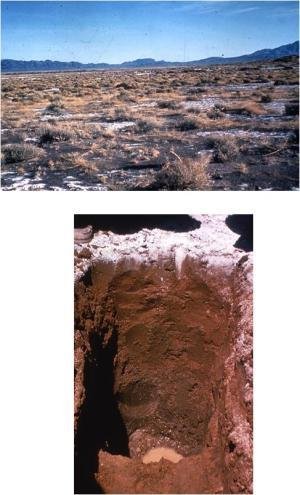{fig-align="center"}

:::

:::

## Caráter carbonático e caráter com carbonato

::: {.columns}

::: {.column}

[__Caráter carbonático__]{.fg style="--col: #e64173"}

Presença de 150 g kg^-1^ ou mais de CaCO~3~ sob qualquer forma de segregação.

::: {.fragment}

[__Caráter com carbonato__]{.fg style="--col: #e64173"}

Presença de CaCO~3~ superior a 50 g kg^-1^ e inferior a 150 g kg^-1^.

:::

:::

::: {.column}

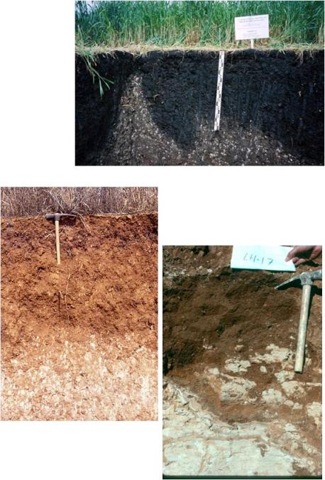{fig-align="center"}

:::

:::

## Mudança textural abrupta

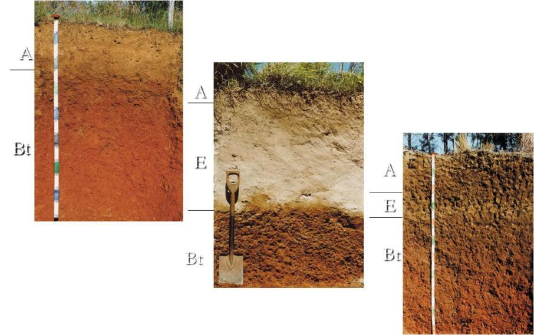{fig-align="center" width="650px"}

## Mudança textural abrupta

Considerável aumento no conteúdo de argila em pequena distância na zona de transição entre o horizonte A ou E e o horizonte subjacente B.

::: {.incremental}

- Quando o A ou E tem **menos de 200 g kg^-1^ de argila**, o conteúdo de argila no B deve dobrar numa distância menor que 7,5 cm (Ex.: A = 150 e B = 300);
- Quando o A ou E tem **200 g kg^-1^ ou mais de argila**, o conteúdo de argila no B deve ser pelo menos 200 g kg^-1^ a mais numa distância de 7,5 cm (Ex.: A = 25% e B = 45%).

:::

## Caráter flúvico

Atributos de solo com forte influência de camadas de deposição, apresentando valores de teor de carbono variáveis em profundidade e/ou presença de camadas interestratificadas em 25% ou mais do volume do solo.

## Plintita e petroplintita

[__Plintita__]{.fg style="--col: #e64173"}

Mistura de argila, pobre em carbono orgânico e **rica em Fe, ou Fe e Al**, com quartzo e outros materiais.

::: {.fragment}

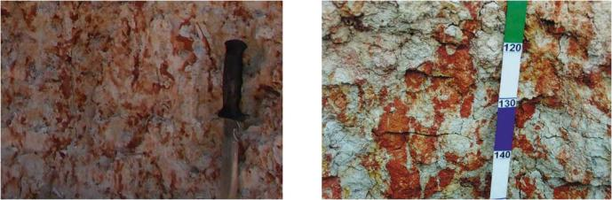{fig-align="center" width="500px"}

:::

## Plintita e petroplintita

[__Petroplintita__]{.fg style="--col: #e64173"}

Material concrecionário duro, proveniente da plintita, que, sob o efeito de ciclos alternados de umedecimento e secagem, sofre consolidação irreversível.

::: {.fragment}

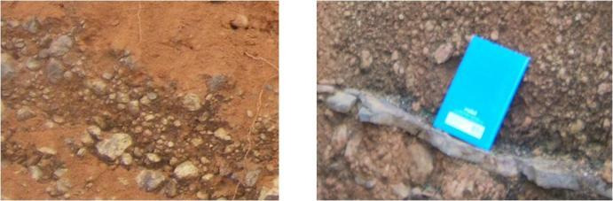{fig-align="center" width="500px"}

:::

## Caráter litoplíntico

Horizonte constituído de 50% ou mais, por volume, de petroplintita de forma contínua e consolidada.

Tem espessura insuficiente para caracterizar horizonte litoplíntico.

## Caráter argilúvico

::: {.incremental}

- Relação textural B/A maior ou igual a 1,4; e/ou
- Ocorre presença de cerosidade no horizonte B, ou E sobrejacente ao B.

:::

## Cerosidade

Películas muito finas de material inorgânico (< 0,002 mm) de diversas naturezas, constituindo revestimentos ou superfícies brilhantes nas faces dos agregados estruturais, poros ou canais, resultantes da movimentação e deposição de material coloidal.

::: {layout-nrow=1}

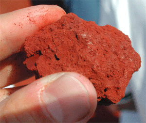{fig-align="center" height="300px"}

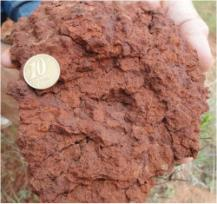{fig-align="center" height="300px"}

:::

## Superfície de fricção ou *slickenside*

::: {.columns}

::: {.column}

Agregados estruturais grandes, com superfície lisa e lustrosa, com estrias, produzida pelo atrito da massa do solo causada pela sua movimentação.

Feição tipicamente encontrada em solos com predomínio de argilominerais 2:1, notadamente esmectitas.

::: {.fragment}

[__Define o caráter vértico.__]{.fg style="--col: #e64173"}

:::

:::

::: {.column}

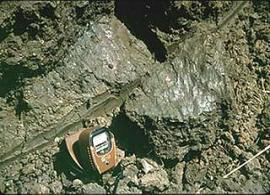{fig-align="center"}

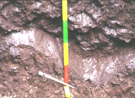{fig-align="center"}

:::

:::

## Caráter plânico

Solos com horizonte adensado, em relação ao superficial, com permeabilidade lenta e cores pouco cromáticas, associadas ou não a mosqueados.

Não satisfaz requisitos para horizonte plânico.

## Caráter coeso

Expressão de consistência dura a extremamente dura (seco), passando a friável a firme (úmido), com ocorrência em transição entre horizontes A e B (30 a 70 cm de espessura).

## Contato lítico

::: {.columns}

::: {.column}

Material subjacente ao solo que não pode ou é muito difícil de ser escavado com pá reta.

Pode ser representado por uma rocha sã ou rochas muito fracamente alteradas (R), ou por rochas fraca a moderadamente alteradas (RCr, CrR).

:::

::: {.column}

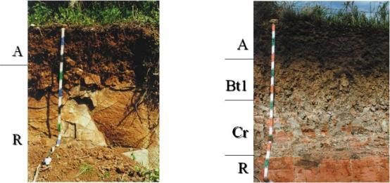{fig-align="center"}

:::

:::

## Contato lítico fragmentário

::: {.columns}

::: {.column}

Tipo de contato lítico em que o material endurecido subjacente ao solo encontra-se fragmentado, usualmente em função de fraturas naturais, possibilitando penetração de raízes e a livre circulação da água.

:::

::: {.column}

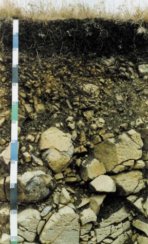{fig-align="center"}

:::

:::

## Materiais sulfídricos

Contêm compostos de enxofre oxidáveis em solos minerais ou orgânicos, localizados em áreas encharcadas ou materiais litológicos, com valor de pH maior do que 3,5.

Amostra de camada de 1 cm de espessura, quando incubada em condições aeróbicas, à temperatura ambiente e com umidade na capacidade de campo, em oito semanas mostra redução no pH de mais de 0,5 unidades.

## Teor de óxidos de ferro (cores do solo)

O emprego do teor de óxidos de ferro (Fe~2~O~3~ do ataque sulfúrico) permite separar:

::: {style="font-size:26px"}

::: {.incremental}

- **Solos hipoférricos**: baixo teor de óxidos de Fe (< 80 g kg^-1^ de solo);
- **Solos mesoférricos**: médio teor de óxidos de Fe (80 a < 180 g kg^-1^ de solo);
- **Solos férricos**: alto teor de óxidos de Fe (180 a < 360 g kg^-1^ de solo) (também aplicado para Nitossolos com teor de óxidos de Fe ≥ 150 g kg^-1^ de solo e < 360 g kg^-1^ de solo);
- **Solos perférricos**: muito alto teor de óxidos de Fe (≥ 360 g kg^-1^ de solo).

:::

:::

## Caráter epiáquico

Ocorre em solos que apresentam lençol freático superficial temporário, resultante de baixa condutividade hidráulica em horizontes inferiores, promovendo saturação temporária de água e processos de redução e segregação de ferro nos horizontes mais superficiais.

## Caráter crômico

Solos que apresentam, na maioria do horizonte B (excluído o BC), predominância de cores (úmida):

::: {.incremental}

- Matiz 7,5YR ou mais amarelo, com valor igual ou maior que 3 e cromas iguais ou maiores que 4; ou
- Matiz mais amarelo que 5YR, valores de 4 a 5 e cromas de 3 a 6.

:::

## Caráter ebânico

Solos que apresentam cores escuras na maior parte do horizonte diagnóstico subsuperficial, com predomínio de cores:

::: {.incremental}

- Para matiz 7,5YR ou mais amarelo: valor < 4 e croma < 3 (úmido) e valor < 6 (seco);
- Para matiz mais vermelho que 7,5YR: preto ou cinzento muito escuro (úmido); valor < 5 (seco).

:::

## Caráter rúbrico

Solos que apresentam matiz mais vermelho que 5YR em alguma parte do perfil do solo, sendo este dominado por coloração brunada (7,5YR ou mais amarelo):

::: {.incremental}

- Valor da amostra úmida < 4 e, em amostra seca, aumento de valor de 1 unidade.

:::

## Gilgai

[__Microrrelevos__]{.fg style="--col: #e64173"}

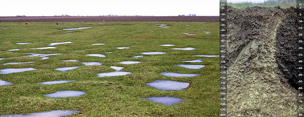{fig-align="center" width="600px"}

## Relação silte/argila

Serve como auxílio na identificação do grau de intemperismo do solo. Solos pouco intemperizados têm relação maior que os mais intemperizados.

::: {.fragment}

Esta relação é usada para diferenciar horizontes B latossólicos de B incipientes. O primeiro deve ter relação silte/argila < 0,7 para solos de textura média e < 0,6 para os de textura argilosa.

:::

## Minerais alteráveis

São aqueles pouco resistentes ao intemperismo:

::: {.incremental}

- Na fração argila: minerais 2:1, talco e glauconita;
- Na fração silte e areia: feldspato, minerais ferromagnesianos, vidros vulcânicos, fragmentos de conchas, apatitas e micas.

:::

# Leitura obrigatória

## Leitura obrigatória

[__Sistema Brasileiro de Classificação de Solos (SiBCS) – 2013__]{.fg style="--col: #e64173"}

{fig-align="center" height="400px"}

# Obrigado pela atenção

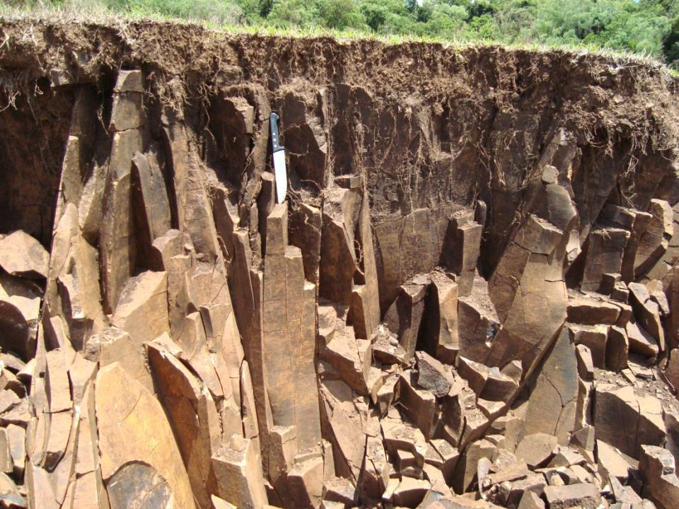{fig-align="center" width="700px"}
