# O que é um solo?

## O que é um solo?

> Corpo natural constituído de materiais minerais e orgânicos, organizados em camadas e/ou horizontes, resultantes da ação de fatores de formação, com destaque para a ação biológica e climática sobre um determinado material de origem (rocha, sedimentos etc.) e numa determinada condição de relevo, através do tempo. O solo contém matéria viva e pode ser vegetado em condições naturais e, eventualmente, ter sido modificado por forte ação antrópica.

# Perfil do solo

## Perfil do solo

[__O que é um perfil?__]{.fg style="--col: #e64173"}

::: {.fragment}

No sentido físico e artístico...

:::

::: {.fragment}

No sentido de redes...

:::

::: {.fragment}

No sentido de trabalho...

:::

## Perfil do solo

A face do solo que vai da superfície ao material de origem (rocha ou sedimentos), usada para fins de exame, descrição e coleta do solo, é chamada de **perfil**.

::: {.fragment}

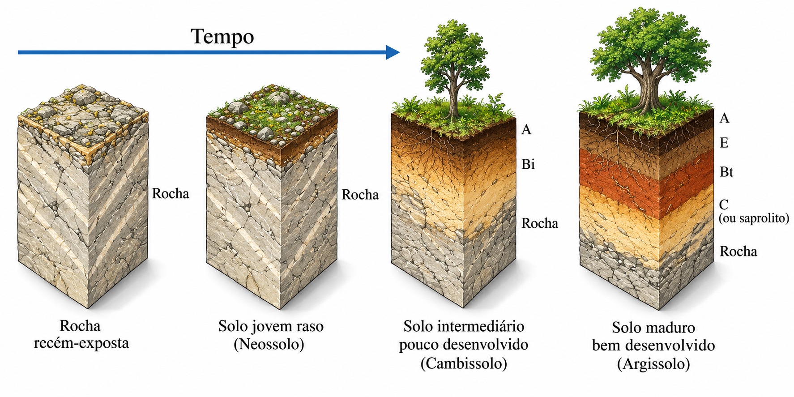{fig-align="center"}

:::

## Perfil do solo

::: {.columns}

::: {.column}

É a seção vertical do solo através de todos os seus horizontes e camadas, estendendo-se para dentro do material de origem.

:::

::: {.column}

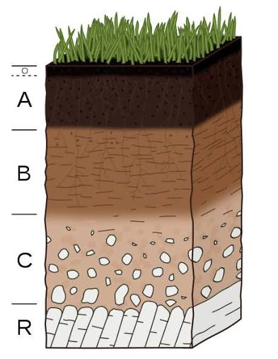{fig-align="center"}

:::

:::

## Perfil do solo

::: {.incremental}

- Horizontes pedogênicos: seções do perfil do solo dotadas de propriedades geradas por processos pedogenéticos.

- Camadas: seções do perfil do solo que possuem propriedades não resultantes ou pouco influenciadas pelos processos pedogenéticos.

- Os horizontes principais podem ser divididos em subhorizontes:
  - Ex: A1, A2, A3 etc. são subhorizontes do horizonte principal A.

:::

## Horizontes do solo

Os horizontes mais próximos da superfície são resultantes da ação dos processos pedogenéticos.

::: {.fragment}

A nomenclatura dos horizontes é dada pelas letras H, O, A, E, B e C, em ordem da superfície em direção ao material de origem.

:::

## Horizontes do solo

[__O__]{.fg style="--col: #e64173"}

::: {.columns}

::: {.column}

Horizonte ou camada superficial de cobertura, de constituição orgânica, sobreposto a alguns solos minerais, podendo estar ocasionalmente saturado com água.

:::

::: {.column}

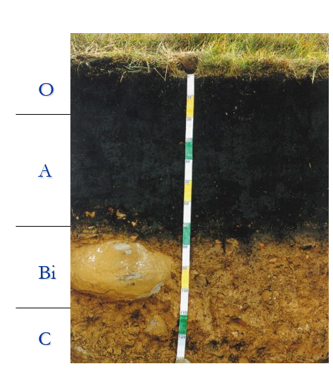{fig-align="center"}

:::

:::

## Horizontes do solo

[__H__]{.fg style="--col: #e64173"}

::: {.columns}

::: {.column}

Horizonte ou camada superficial de cobertura, de constituição orgânica, superficial ou não, composto de resíduos acumulados ou em acumulação sob condições de prolongada estagnação de água, salvo se artificialmente drenado.

Composto por matéria orgânica em vários estádios de decomposição.

Relacionado a solos orgânicos com condições de hidromorfismo.

:::

::: {.column}

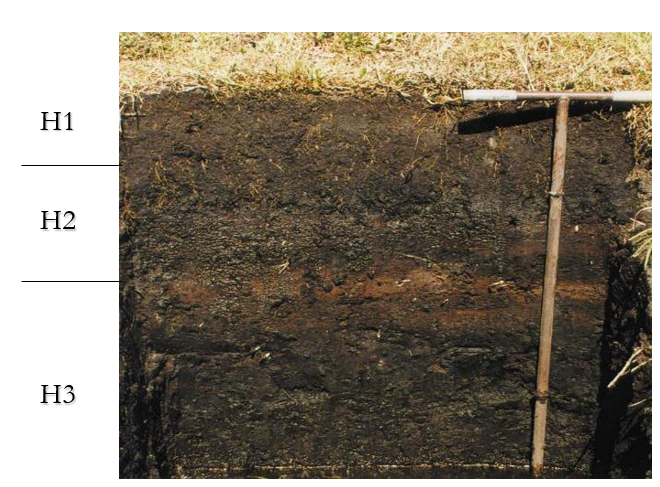{fig-align="center"}

:::

:::

## Horizontes do solo

[__A__]{.fg style="--col: #e64173"}

::: {.columns}

::: {.column}

Horizonte ou camada em sequência a um horizonte ou camada O ou H, de concentração de matéria orgânica decomposta ou de composição mineral.

As características do horizonte A são tipicamente influenciadas pela matéria orgânica.

:::

::: {.column}

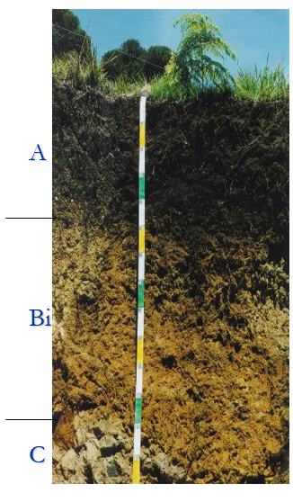{fig-align="center"}

:::

:::

## Horizontes do solo

[__E__]{.fg style="--col: #e64173"}

::: {.columns}

::: {.column}

Horizonte mineral, cuja característica principal é a perda de argila, ferro, alumínio ou matéria orgânica, com consequente concentração residual de areia e silte constituídos de quartzo ou outros minerais resistentes.

:::

::: {.column}

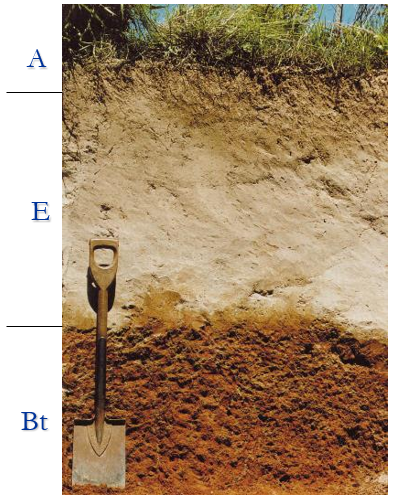{fig-align="center"}

:::

:::

## Horizontes do solo

[__B__]{.fg style="--col: #e64173"}

::: {.columns}

::: {.column}

Horizonte mineral formado sob um E, A ou O, bastante afetado por transformações pedogenéticas, em que pouco ou nada resta da estrutura original da rocha. Pode ser encontrado na superfície quando da ausência ou remoção de um E, A ou O por erosão.

:::

::: {.column}

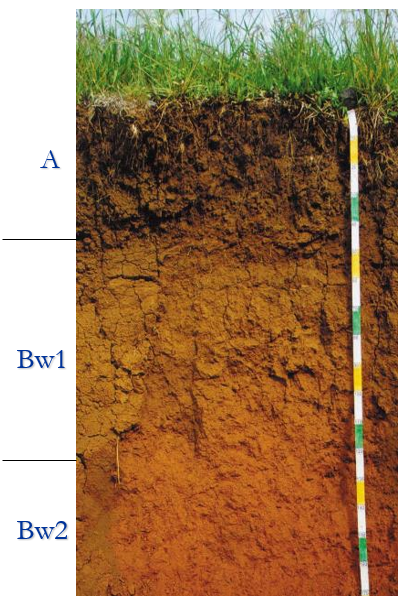{fig-align="center"}

:::

:::

## Horizontes do solo

[__C__]{.fg style="--col: #e64173"}

::: {.columns}

::: {.column}

Horizonte ou camada mineral de material inconsolidado sob o sólum, relativamente pouco afetado por processos pedogenéticos, similar ao material do qual o sólum pode ou não ter se formado.

:::

::: {.column}

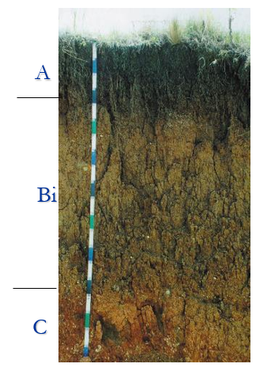{fig-align="center"}

:::

:::

## Horizontes do solo

[__R__]{.fg style="--col: #e64173"}

::: {.columns}

::: {.column}

Camada mineral de material consolidado (coeso) que, quando úmido, não pode ser cortado com uma pá, constituindo substrato rochoso contínuo ou praticamente contínuo.

:::

::: {.column}

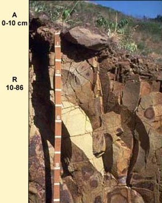{fig-align="center"}

:::

:::

# Descrição geral do perfil de solo

## Descrição geral do perfil de solo

O que deve conter uma descrição:

::: {.incremental}

- Data;
- Classificação do solo (veremos adiante);
- Localização: município, estado e coordenadas;
- Situação: declividade e cobertura vegetal;
- Unidade litoestratigráfica;
- Cronologia;
- Material originário;
- Pedregosidade;
- Rochosidade;
- Relevo local;

:::

## Descrição geral do perfil de solo

O que deve conter uma descrição:

::: {.incremental}

- Relevo regional;
- Erosão;
- Drenagem;
- Vegetação primária;
- Uso atual;
- Clima;
- Descrito e coletado por.

:::

## Descrição geral do perfil de solo - Exemplo

::: {style="font-size:22px"}

**Perfil: SC-PR (Exemplo para aula)**

**Data:** 19/10/2026.

**Classificação do solo:** Latossolo Vermelho distroférrico típico, textura muito argilosa, A moderado, fase floresta tropical subperenifólia, relevo suave ondulado.

**Localização:** Município de Londrina, estado do Paraná, Brasil. Coordenadas geográficas fictícias: 23°20'00" S e 51°10'00" O.

**Situação:** Perfil localizado no terço médio de uma vertente, com declividade de aproximadamente 5%, sob cultivo de soja em sistema de plantio direto.

**Unidade litoestratigráfica:** Formação Serra Geral.

**Cronologia:** Mesozoico, período Cretáceo.

**Material originário:** Produtos da alteração de rochas basálticas.

**Pedregosidade:** Ausente na superfície.

:::

## Descrição geral do perfil de solo - Exemplo

::: {style="font-size:22px"}

**Rochosidade:** Ausente na superfície.

**Relevo local:** Suave ondulado.

**Relevo regional:** Predominantemente suave ondulado a ondulado.

**Erosão:** Laminar ligeira, sem ocorrência de sulcos expressivos.

**Drenagem:** Bem drenado.

**Vegetação primária:** Floresta Estacional Semidecidual, pertencente ao bioma Mata Atlântica.

**Uso atual:** Agricultura mecanizada, com cultivo de soja no verão e milho na segunda safra, em sistema de plantio direto.

**Clima:** Cfa — clima subtropical úmido, segundo a classificação de Köppen, com verões quentes e ausência de estação seca bem definida.

**Descrito e coletado por:** Gustavo Frosi.

:::

# Descrição morfológica de um perfil de solo

## Descrição morfológica de um perfil de solo

O solo apresenta características externas e internas (morfológicas) próprias, que devem ser descritas com critério, uma vez que, a partir delas, se tem uma visão integrada do solo e de suas relações com a paisagem.

::: {.fragment}

Permitem inferências importantes sobre a formação e o comportamento do solo.

::: {.incremental}

- Capacidade de produzir de forma sustentada, adequação às práticas agrícolas, propensão à erosão, salinização, riscos de degradação etc.

:::

:::

## Descrição morfológica de um perfil de solo

O estudo da morfologia do solo refere-se à descrição de características detectadas pelos sentidos da visão e do tato.

::: {.incremental}

- Cor;
- Textura;
- Estrutura;
- Porosidade;
- Consistência;
- Transição entre horizontes.

:::

## Descrição morfológica de um perfil de solo

As características morfológicas são descritas em cada horizonte ou camada, pois podem variar ao longo do perfil.

::: {.fragment}

São padronizadas e possuem metodologia própria.

:::

## Descrição morfológica de um perfil de solo

[__Espessura do horizonte ou camada:__]{.fg style="--col: #e64173"}

distância vertical entre o início e o final do horizonte.

::: {.fragment}

Ex: Um solo possui um horizonte O com 5 cm de espessura, um horizonte A com 50 cm de espessura e um horizonte B com 200 cm de espessura.

:::

::: {.fragment}

[__Profundidade do horizonte ou camada:__]{.fg style="--col: #e64173"}

distância vertical entre o início e o final de um horizonte e a superfície do horizonte A (superfície do solo).

::: {.fragment}

Ex: Um solo possui um horizonte O com profundidade de 0 a 5 cm, um horizonte A com profundidade de 0 a 50 cm e um horizonte B com profundidade de 50 a 125 cm.

:::

:::

## Descrição morfológica de um perfil de solo

[__Transição do horizonte ou camada:__]{.fg style="--col: #e64173"}

se refere à nitidez ou ao contraste de separação entre os horizontes ou camadas (facilidade de distinguir entre as camadas ou horizontes).

::: {.columns}

::: {.column}

::: {.fragment}

Pode ser por distinção:

- Abrupta: < 2,5 cm;
- Clara: 2,5 a 7,5 cm;
- Gradual: 7,5 a 12 cm;
- Difusa: > 12 cm.

:::

:::

::: {.column}

::: {.fragment}

Pode ser por topografia:

- Horizontal;
- Ondulada;
- Irregular;
- Descontínua.

:::

:::

:::

## Descrição morfológica de um perfil de solo

[__Transição do horizonte ou camada:__]{.fg style="--col: #e64173"}

::: {layout-nrow=1}

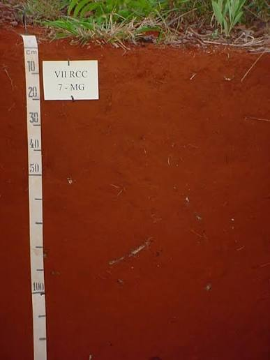{fig-align="center" width="350px"}

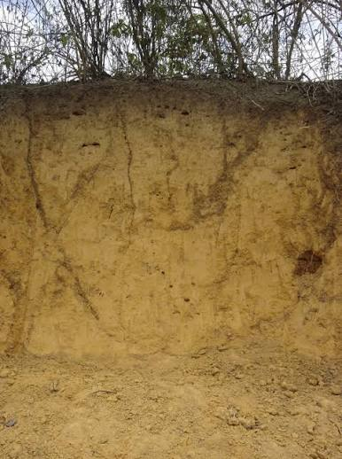{fig-align="center" width="350px"}

:::

## Descrição morfológica de um perfil de solo

[__Transição do horizonte ou camada:__]{.fg style="--col: #e64173"}

::: {layout-nrow=1}

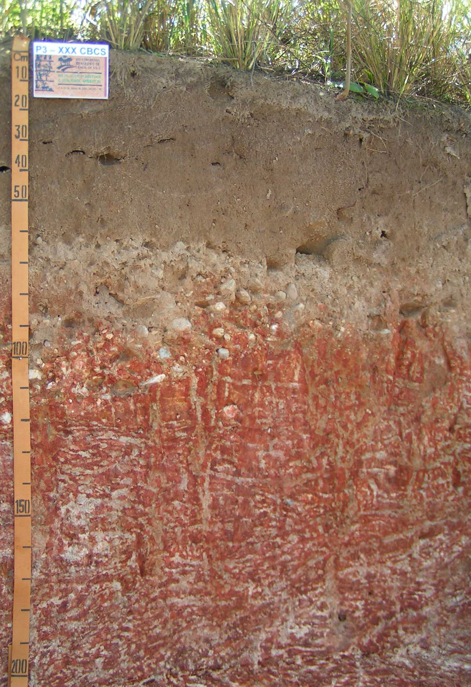{fig-align="center" width="350px"}

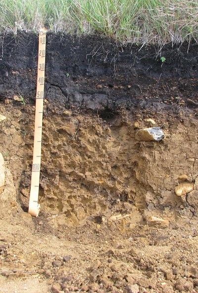{fig-align="center" width="350px"}

:::

## Descrição morfológica de um perfil de solo

[__Transição do horizonte ou camada:__]{.fg style="--col: #e64173"}

::: {layout-nrow=1}

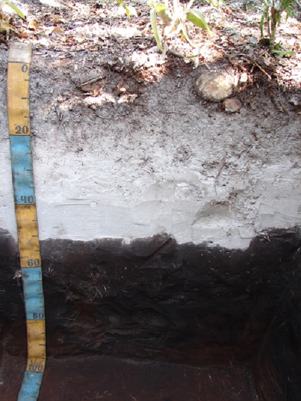{fig-align="center" width="350px"}

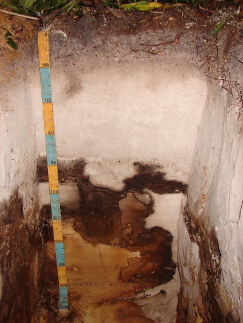{fig-align="center" width="350px"}

:::

## Descrição morfológica de um perfil de solo

[__Horizontes transicionais miscigenados:__]{.fg style="--col: #e64173"}

são horizontes nos quais as propriedades de dois horizontes principais se associam conjuntamente em fusão, evidenciando a coexistência de propriedades comuns a ambos, de tal modo que não há individualização de partes distintas de um e de outro.

::: {.fragment}

Ex: AB, BE, EB, BC

:::

::: {.fragment}

[__Horizontes transicionais mesclados:__]{.fg style="--col: #e64173"}

com visualização de partes distintas de um e de outro.

::: {.fragment}

Ex: A/B, B/C, E/B

:::

:::

## Descrição morfológica de um perfil de solo

::: {layout-nrow=1}

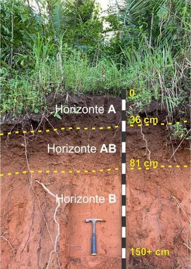{fig-align="center" width="350px"}

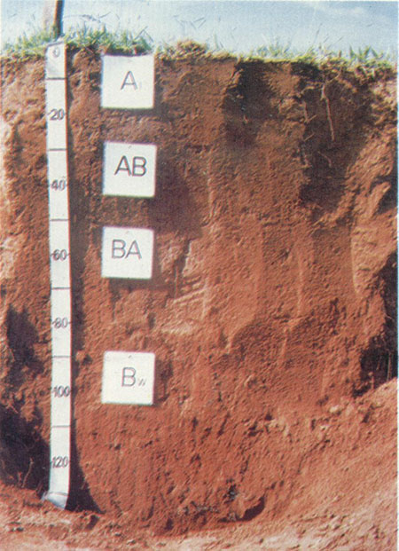{fig-align="center" width="350px"}

:::

## Descrição morfológica de um perfil de solo

Horizontes podem conter características específicas. A designação destas se dá por meio de sufixos (letras minúsculas).

::: {.fragment style="font-size:24px"}
- a: propriedades ândicas
- b: horizonte enterrado
- c: concreções ou nódulos endurecidos
- d: acentuada decomposição de material orgânico
- e: escurecimento da parte externa dos agregados por matéria orgânica não associada a sesquióxidos
- f: material plíntico e/ou bauxítico brando (laterita)
- g: **glei**
- h: acumulação iluvial de matéria orgânica
- i: incipiente desenvolvimento de horizonte B
- j: tiomorfismo
- k: presença de carbonatos
- m: extremamente cimentado

:::

## Descrição morfológica de um perfil de solo

:::{style="font-size:24px"}

- n: acumulação de sódio trocável
- o: material orgânico mal ou não decomposto
- p: aração ou outras pedoturbações
- q: acumulação de sílica
- r: rocha branda ou saprólito
- s: acumulação iluvial de sesquióxidos com matéria orgânica
- t: **acumulação de argila**
- u: modificações ou acumulações antropogênicas
- v: características vérticas
- w: **intensa alteração com inexpressiva acumulação de argila, com ou sem concentração de sesquióxidos**
- x: cimentação aparente, reversível
- y: acumulação de sulfato de cálcio
- z: acumulação de sais mais solúveis em água fria que sulfato de cálcio

:::

## Descrição morfológica de um perfil de solo

[__Cor:__]{.fg style="--col: #e64173"}

A cor é determinada com o auxílio da Carta de Munsell (Munsell Soil Color Charts), na qual serão identificados **matiz**, **valor** e **croma**.

::: {.fragment}

Importância:

- Drenagem;
- Composição mineralógica;
- Concentrações de elementos;
- Processos pedogenéticos.

:::

## Descrição morfológica de um perfil de solo

[__Cor:__]{.fg style="--col: #e64173"}

::: {layout-nrow=1}

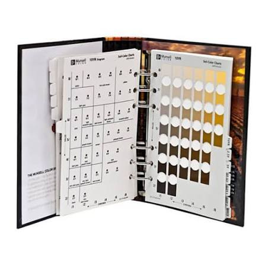{fig-align="center" width="450px"}

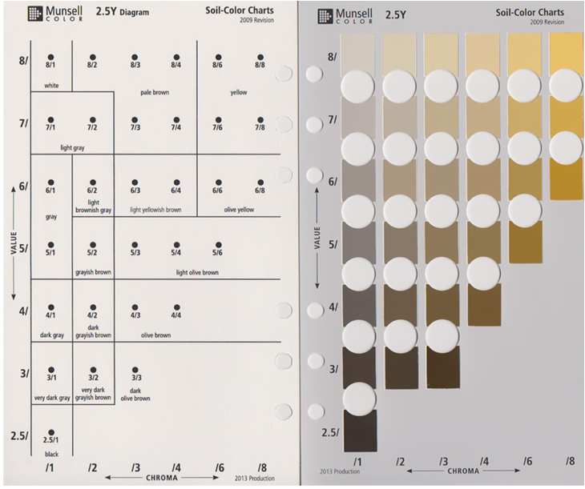{fig-align="center" width="450px"}

:::

## Descrição morfológica de um perfil de solo

[__Sistema de cor de Munsell:__]{.fg style="--col: #e64173"}

Três são as variáveis utilizadas para representar cores no sistema Munsell.

::: {.fragment}

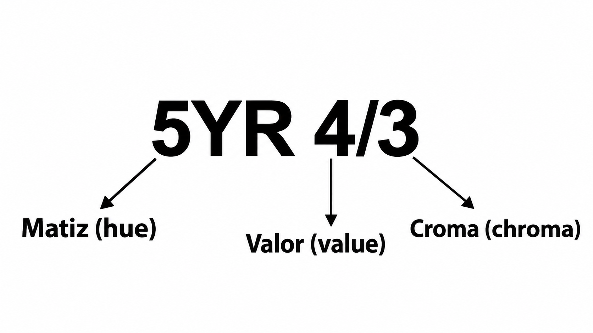{fig-align="center"}

:::

## Descrição morfológica de um perfil de solo

[__Sistema de cor de Munsell:__]{.fg style="--col: #e64173"}

::: {.columns}

::: {.column}

O primeiro conjunto de números e letras representa o **matiz (hue)**.

O matiz representa a posição da cor no círculo de cores (Y = amarelo; R = vermelho; G = verde; B = azul; YR = amarelo-vermelho; RY = vermelho-amarelo).

:::

::: {.column}

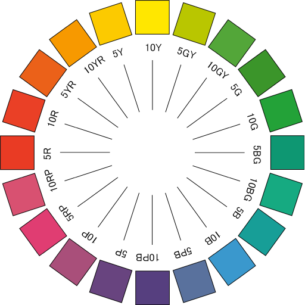{fig-align="center"}

:::

:::

## Descrição morfológica de um perfil de solo

[__Sistema de cor de Munsell:__]{.fg style="--col: #e64173"}

::: {.columns}

::: {.column}

O primeiro número após a barra é o **valor (value)**.

O valor está relacionado a quão clara ou escura é uma cor. É um componente da cor que representa os tons de preto e de branco, ligado ao brilho da cor. No sistema de Munsell são utilizados números de 0 a 10.

:::

::: {.column}

 
 
 

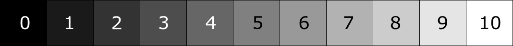{fig-align="center"}

:::

:::

## Descrição morfológica de um perfil de solo

[__Sistema de cor de Munsell:__]{.fg style="--col: #e64173"}

::: {.columns}

::: {.column}

O segundo número após a barra é o **croma (chroma)**.

Este está relacionado à intensidade da cor (quão viva ela é).

Ex: verde claro e verde escuro.

:::

::: {.column}

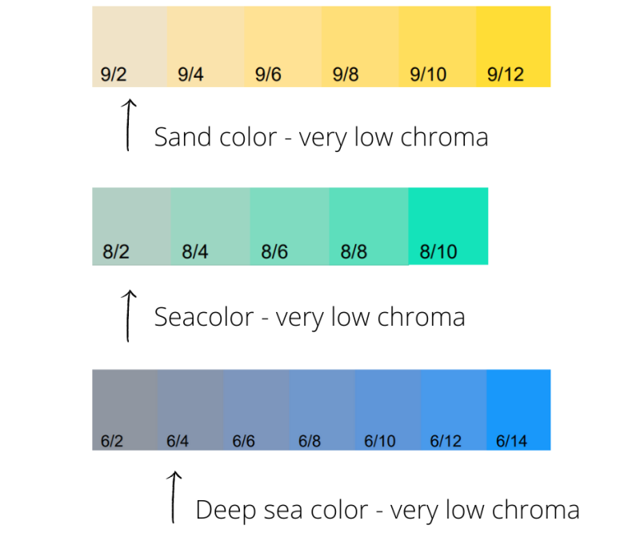{fig-align="center"}

:::

:::

## Descrição morfológica de um perfil de solo

[__Sistema de cor de Munsell:__]{.fg style="--col: #e64173"}

::: {layout-nrow=1}

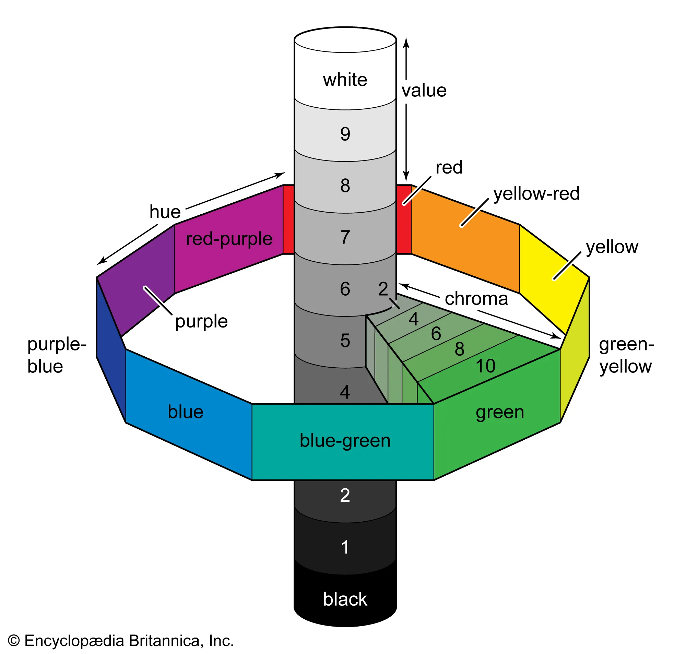{fig-align="center" width="450px"}

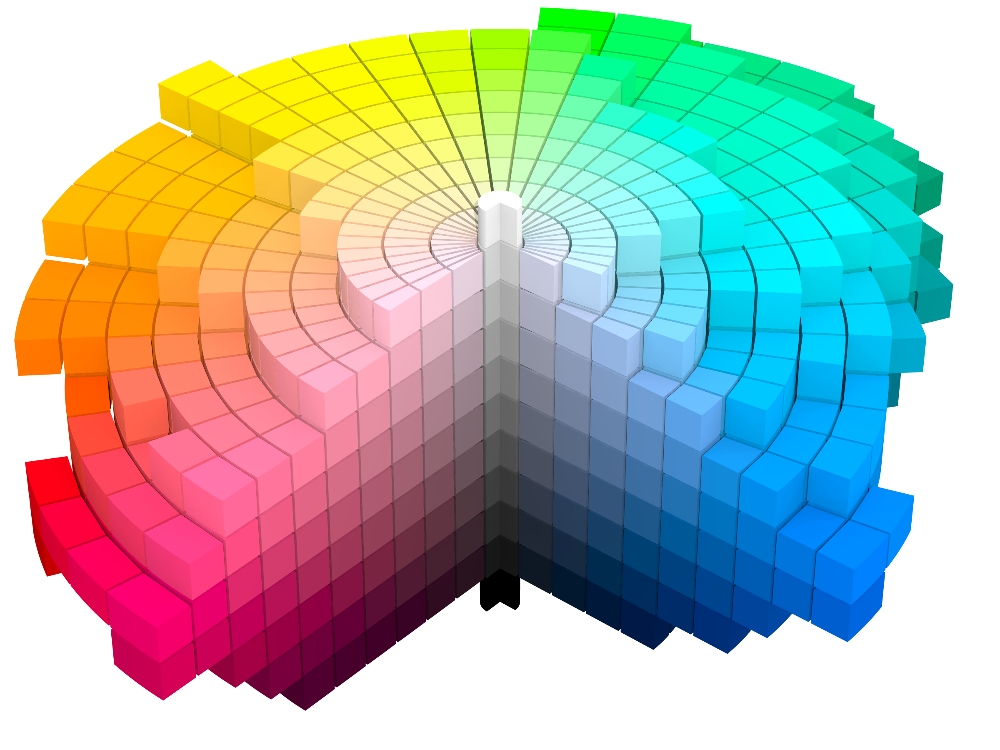{fig-align="center" width="450px"}

:::

## Descrição morfológica de um perfil de solo

[__Sistema de cor de Munsell:__]{.fg style="--col: #e64173"}

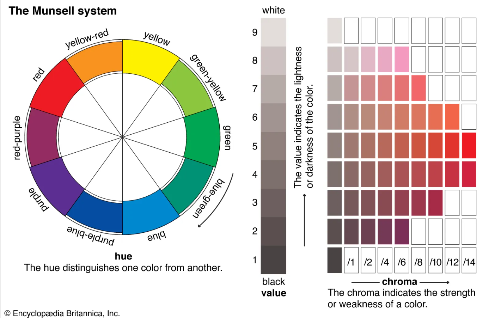{fig-align="center"}

## Descrição morfológica de um perfil de solo

[__Cor:__]{.fg style="--col: #e64173"}

A cor pode ser descrita com a amostra de solo úmida (mais usual), seca, seca triturada ou úmida amassada. Caso o horizonte apresente mosqueados (manchas de outra cor), deverão ser anotados a cor, a quantidade e o contraste desse mosqueado.

# Cor - curiosidade

## Cor - curiosidade

Qual a cor do quadrado?

{fig-align="center"}

## Cor - curiosidade

Qual a cor do quadrado?

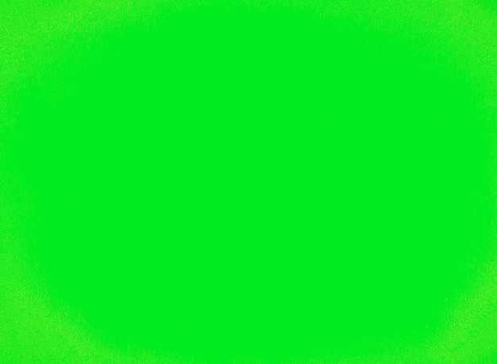{fig-align="center"}

## Cor - curiosidade

Adivinhando...

{fig-align="center"}

## Cor - curiosidade

Como é possível que todos nós enxerguemos a mesma cor, projetada artificialmente por uma tela?

::: {.fragment}

Como é possível simular essa cor de forma artificial, mas da mesma forma como a observamos na natureza?

:::

::: {.fragment}

Em 1931, a Comissão Internacional de Iluminação (CIE) publicou os espaços de cor CIE 1931, que definem a relação entre o espectro visível e a visão humana das cores.

:::

## Cor - curiosidade

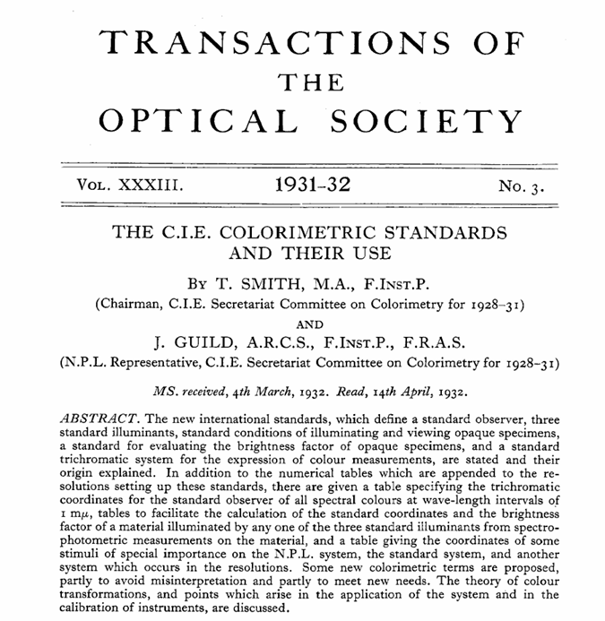{fig-align="center" width="450px"}

## Cor - curiosidade

> Em princípio, qualquer sensação de cor humana pode ser descrita por um conjunto de valores triestímulo.

::: {layout-nrow=1}

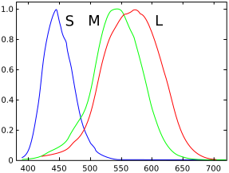{fig-align="center" width="450px"}

:::

## Descrição morfológica de um perfil de solo

[__Textura:__]{.fg style="--col: #e64173"}

Corresponde à proporção relativa das frações granulométricas do solo.

::: {.fragment}

Pelo tato, com a amostra de solo molhada.

Procedimento: pegue uma amostra de solo do tamanho de um ovo pequeno e adicione água suficiente para umedecê-la.

- Amasse a amostra até que a umidade seja uniforme.

- Aperte a amostra entre os dedos e estime a composição granulométrica.

:::

## Descrição morfológica de um perfil de solo

[__Textura:__]{.fg style="--col: #e64173"}

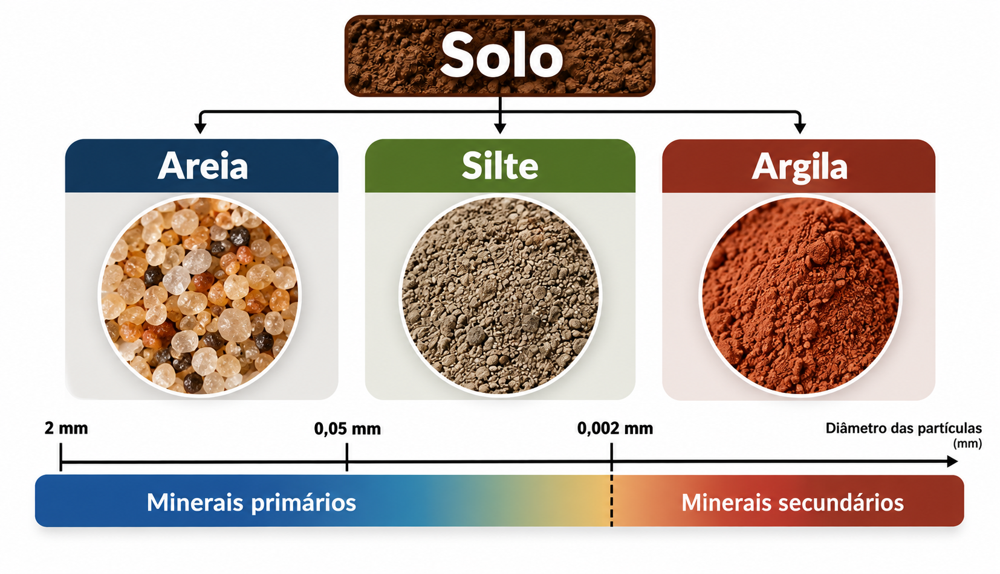{fig-align="center"}

## Descrição morfológica de um perfil de solo

[__Textura:__]{.fg style="--col: #e64173"}

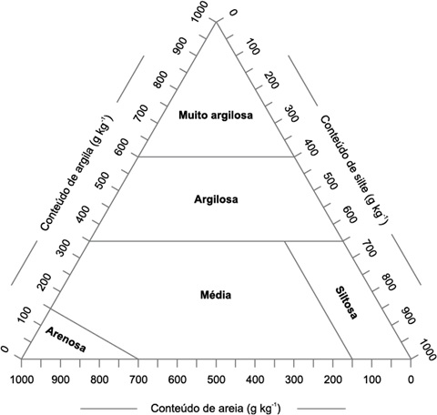{fig-align="center"}

## Descrição morfológica de um perfil de solo

[__Textura:__]{.fg style="--col: #e64173"}

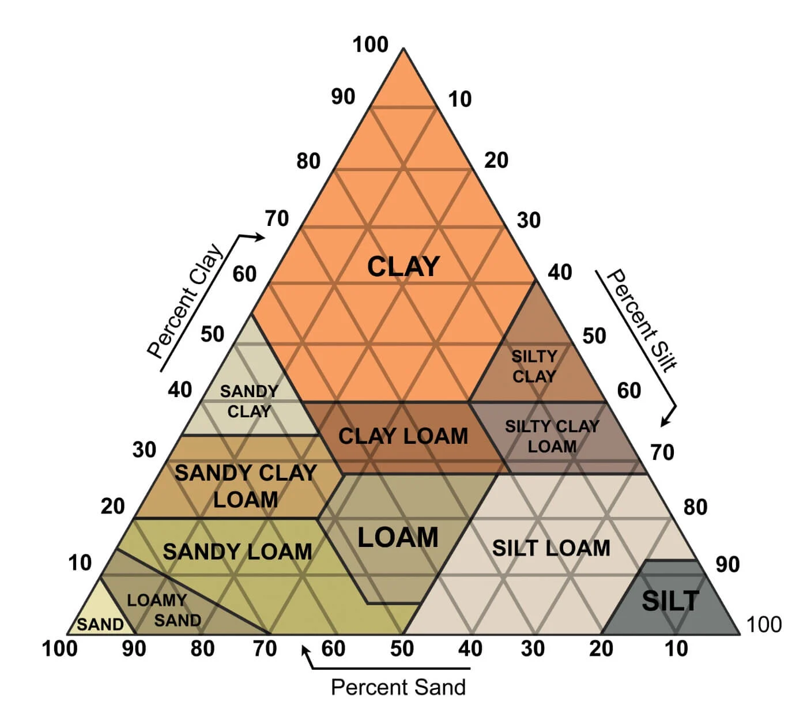{fig-align="center"}

## Descrição morfológica de um perfil de solo

[__Textura:__]{.fg style="--col: #e64173"}

::: {.columns}

::: {.column style="font-size:24px"}

Avalie primeiro o teor de argila: se a amostra é muito pegajosa, firme e plástica, e é possível formar um cilindro de 4 a 5 cm, classifique como **muito argilosa**.

Se o solo é parecido com argila, porém se sente ligeiramente pegajoso e é mais fácil de amassar, classifique como **franco-argiloso**.

Se o solo parece suave, uniforme e fácil de espremer (muito diferente de uma argila), classifique como **franca**.

:::

::: {.column}

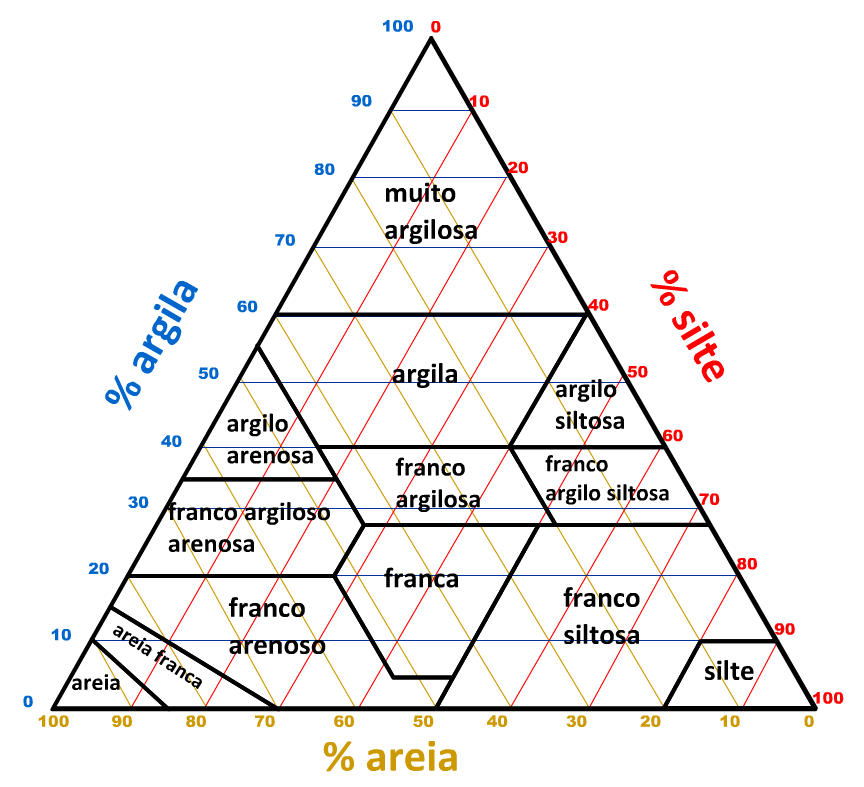{fig-align="center"}

:::

:::

## Descrição morfológica de um perfil de solo

[__Textura:__]{.fg style="--col: #e64173"}

::: {.columns}

::: {.column style="font-size:24px"}

A seguir, analise a quantidade de areia.

Se o solo é áspero, adicione a palavra **arenoso** à sua classificação original.

Se o solo parece mais suave, sem a aspereza da areia, adicione a palavra **silte** ou **siltoso** à sua classificação.

Se não houver muita aspereza nem suavidade, mesmo que se perceba areia na amostra, mantenha o nome original.

:::

::: {.column}

{fig-align="center"}

:::

:::

## Descrição morfológica de um perfil de solo

[__Estrutura:__]{.fg style="--col: #e64173"}

A estrutura é a agregação das partículas primárias do solo em unidades estruturais compostas, separadas entre si por superfícies de fraqueza.

::: {.incremental}

- É avaliada quanto a:
  - tipo (laminar, prismática, blocos angulares, blocos subangulares e granular);
  - classe (muito pequena, pequena, média, grande, muito grande);
  - grau de estrutura (sem estrutura: grãos simples; sem estrutura: maciça; com estrutura fraca, moderada ou forte).

:::

## Descrição morfológica de um perfil de solo

[__Estrutura:__]{.fg style="--col: #e64173"}

Quanto ao tipo

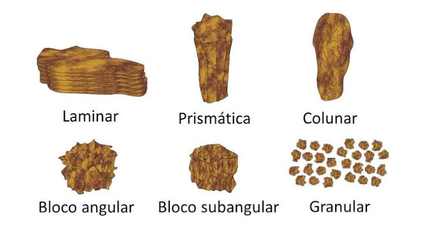{fig-align="center"}

## Descrição morfológica de um perfil de solo

[__Porosidade:__]{.fg style="--col: #e64173"}

## Descrição morfológica de um perfil de solo

[__Cerosidade:__]{.fg style="--col: #e64173"}

## Descrição morfológica de um perfil de solo

[__Superfícies de compressão e de fricção:__]{.fg style="--col: #e64173"}

## Descrição morfológica de um perfil de solo

[__Consistência:__]{.fg style="--col: #e64173"}

## Descrição morfológica de um perfil de solo

[__Cimentação:__]{.fg style="--col: #e64173"}

## Descrição morfológica de um perfil de solo

[__Nódulos e concreções minerais:__]{.fg style="--col: #e64173"}

## Descrição morfológica de um perfil de solo

[__Presença de minerais magnéticos:__]{.fg style="--col: #e64173"}

## Descrição morfológica de um perfil de solo

[__Presença de carbonatos:__]{.fg style="--col: #e64173"}

## Descrição morfológica de um perfil de solo

[__Presença de manganês:__]{.fg style="--col: #e64173"}

## Descrição morfológica de um perfil de solo

[__Presença de sulfetos:__]{.fg style="--col: #e64173"}

## Descrição morfológica de um perfil de solo

[__Eflorescências:__]{.fg style="--col: #e64173"}

## Descrição morfológica de um perfil de solo

[__Coesão:__]{.fg style="--col: #e64173"}
