# Classificação taxonômica do solo

## Classificação taxonômica do solo

::: {.incremental}

- Atributos diagnósticos;
- Horizontes diagnósticos;
- Ordens de solos.

:::

## Material de consulta

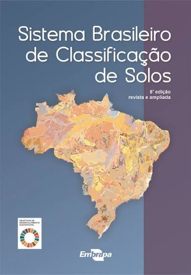{fig-align="center" height="500px"}

## Análises químicas e físicas

::: {style="font-size:18px"}

| Perfil | Hz. | Calhaus | Cascalho | Terra fina | Areia grossa | Areia fina | Silte | Argila | Argila natural | GF | Silte/Argila |
|:--:|:--:|:--:|:--:|:--:|:--:|:--:|:--:|:--:|:--:|:--:|:--:|
|    |    | g kg^-1^ | g kg^-1^ | g kg^-1^ | g kg^-1^ | g kg^-1^ | g kg^-1^ | g kg^-1^ | % | % | |
| P1 | Ap  | 0   | 0   | 1000 | 250 | 513 | 130 | 107 | 27 | 75 | 1,21 |
|    | A   | 0   | 0   | 1000 | 194 | 533 | 135 | 140 | 34 | 76 | 0,96 |
|    | Cr1 | 603 | 306 | 91   | 163 | 542 | 134 | 161 | 35 | 78 | 0,83 |
|    | Cr2 | 930 | 60  | 10   | -   | -   | -   | -   | -  | -  | -    |
|    | RCr | 940 | 50  | 10   | -   | -   | -   | -   | -  | -  | -    |

:::

::: {style="font-size:18px"}

| Perfil | Hz. | pH H~2~O | pH KCl | ∆pH | Ca | Mg | Na | K | Al | H+Al | CTC | V (%) | m (%) | C~org~ (g kg^-1^) |
|:--:|:--:|:--:|:--:|:--:|:--:|:--:|:--:|:--:|:--:|:--:|:--:|:--:|:--:|:--:|
| P1 | Ap  | 4,60 | 3,15 | -1,46 | 1,44 | 0,20 | 0,27 | 0,25 | 3,22 | 13,69 | 15,85 | 13,6 | 59,85 | 11,0 |
|    | A   | 4,40 | 2,94 | -1,46 | 2,49 | 0,02 | 0,16 | 0,14 | 4,24 | 17,71 | 20,52 | 13,7 | 60,05 | 9,2  |
|    | Cr1 | 4,35 | 2,95 | -1,40 | 4,24 | 0,14 | 0,18 | 0,15 | 6,02 | 22,62 | 27,33 | 17,2 | 56,10 | 10,6 |

Ca, Mg, Na, K, Al, H+Al e CTC em cmol~c~ kg^-1^.

:::

# Horizontes diagnósticos

## Horizonte pedogenético x horizonte diagnóstico

[__Horizonte pedogenético__]{.fg style="--col: #e64173"}

Cada uma das seções do solo resultantes dos processos pedogenéticos e que guardam relações entre si. Estas seções (horizontes) estão separadas entre si geralmente em função de algum aspecto morfológico (cor).

## Horizonte pedogenético x horizonte diagnóstico

[__Horizonte diagnóstico__]{.fg style="--col: #e64173"}

Corresponde a uma seção do solo que apresenta determinados atributos para fins de classificação do solo.

::: {.fragment}

Não são sinônimos dos horizontes pedogenéticos A (A1 e A2), uma vez que podem ser mais estreitos que o A1 ou incluir todo o A e parte(s) do B.

:::

# Horizontes diagnósticos superficiais

## Horizonte hístico

::: {.columns}

::: {.column}

É um horizonte superficial essencialmente de constituição orgânica.

:::

::: {.column}

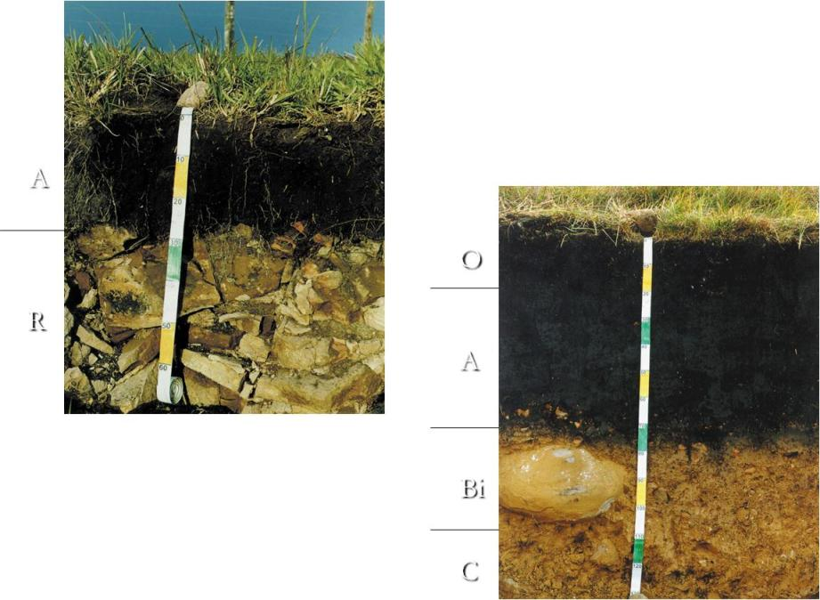{fig-align="center"}

:::

:::

## Horizonte hístico

[__Requisitos:__]{.fg style="--col: #e64173"}

Horizonte superficial de constituição orgânica, contendo pelo menos 80 g kg^-1^ de C-org, resultante de acumulações vegetais depositadas superficialmente.

::: {.incremental}

- Espessura ≥ 20 cm;
- Espessura maior que 40 cm quando 75% ou mais do volume do horizonte for constituído de fibras vegetais;
- Espessura de 10 cm ou mais quando assentado sobre um contato lítico.

:::

## Horizonte A chernozêmico

::: {.columns}

::: {.column}

Horizonte relativamente espesso, de cor escura, que atende:

::: {.incremental}

- Estrutura desenvolvida, com agregação e grau de desenvolvimento moderado ou forte;
- Saturação por bases (V%) > 65%, predominando Ca e Mg;
- Conteúdo de CO > 6 g kg^-1^ e < 80 g kg^-1^ de solo.

:::

:::

::: {.column}

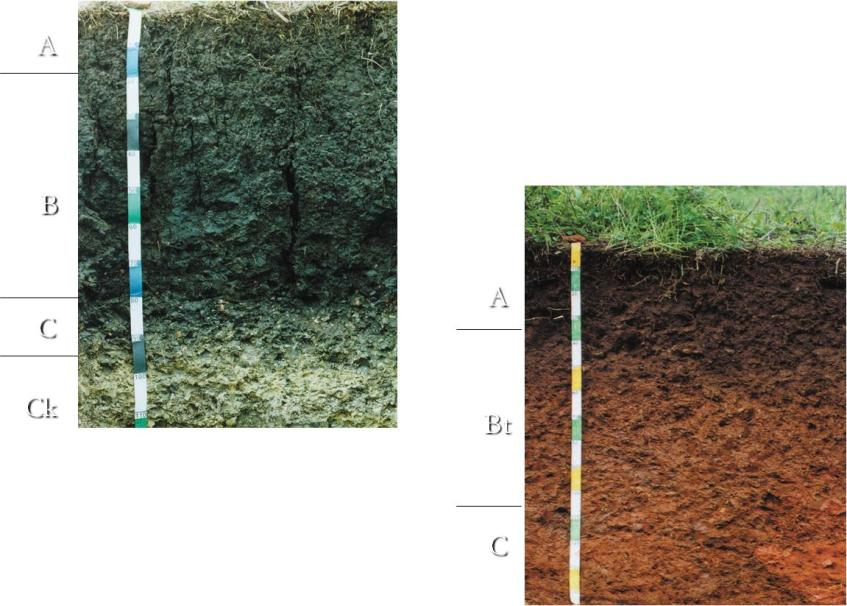{fig-align="center"}

:::

:::

## Horizonte A chernozêmico

::: {.incremental}

- [__Espessura:__]{.fg style="--col: #e64173"} no mínimo 10 cm quando imediatamente acima da rocha; ou 18 cm no mínimo se o solo tiver menos de 75 cm de espessura; ou 25 cm no mínimo, incluindo os horizontes transicionais, se o solo tiver mais de 75 cm;
- [__Estrutura:__]{.fg style="--col: #e64173"} bem desenvolvida;
- [__Cor:__]{.fg style="--col: #e64173"} valor e croma ≤ 3 (úmido) e valor ≤ 5 (seco);
- [__Saturação por bases (V%):__]{.fg style="--col: #e64173"} 65% ou mais;
- [__Carbono orgânico:__]{.fg style="--col: #e64173"} ≥ 0,6%.

:::

## Horizonte A proeminente

Características similares às do A chernozêmico no que se refere a cor, teor de carbono, consistência, estrutura e espessura.

::: {.fragment}

Difere apenas por apresentar **saturação por bases (V%) < 65%**.

:::

## Horizonte A húmico

::: {.columns}

::: {.column style="font-size:24px"}

Horizonte de cor escura, saturação por bases inferior a 65%, apresentando espessura e teor de carbono dentro dos seguintes limites:

::: {.incremental}

- Teor de carbono orgânico inferior ao limite mínimo para caracterizar o horizonte hístico;
- Espessura mínima comparável ao A chernozêmico;
- O somatório do produto do teor de carbono orgânico de cada subhorizonte A pela espessura do subhorizonte deve ser igual ou maior, e proporcional, à média ponderada do teor de argila dos subhorizontes A, de acordo com a equação a seguir.

:::

:::

::: {.column}

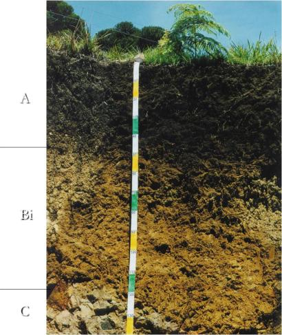{fig-align="center"}

:::

:::

## Horizonte A húmico

$$
\sum \left( C_{org}\ (g\ kg^{-1}) \times espessura\ (dm) \right) > 60 + \left( 0{,}1 \times \overline{argila}\ (g\ kg^{-1}) \right)
$$

Em que $\overline{argila}$ é a média ponderada do teor de argila do horizonte superficial.

## Horizonte A húmico

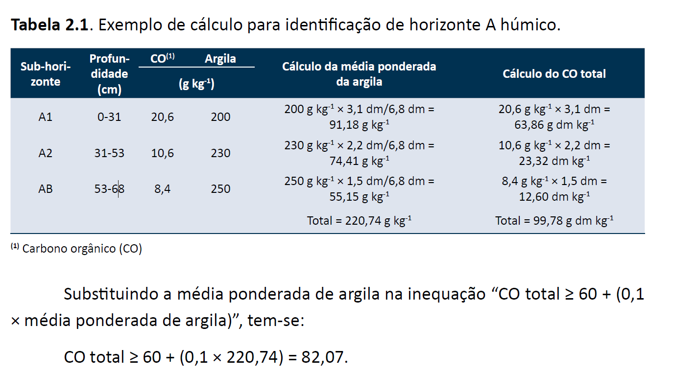{fig-align="center"}

::: {.fragment}

**O valor de CO total no horizonte A é de 99,78, portanto, maior que 82,07. Assim, o horizonte usado como exemplo é húmico.**

:::

## Horizonte A fraco

Fracamente desenvolvido, sendo identificado pelas seguintes características:

::: {.incremental}

- Cor do solo com valor ≥ 4,0 quando úmido e ≥ 6,0 quando seco;
- Estrutura em grãos simples, maciça, ou com grau fraco de desenvolvimento;
- Teor de carbono inferior a 6 g kg^-1^; e
- Espessura < 5 cm, não importando as demais condições anteriores.

:::

## Horizonte A antrópico

Horizonte formado ou modificado pelo homem pelo uso prolongado.

::: {.incremental}

- Espessura maior ou igual a 20 cm;
- Fósforo disponível ≥ 30 mg kg^-1^.

:::

## Horizonte A moderado

Não se enquadra em nenhuma das definições anteriores.

::: {.fragment}

Geralmente difere do A chernozêmico, proeminente e húmico pela espessura e/ou pela cor, e do A fraco pelo teor de carbono e estrutura.

:::

# Horizontes diagnósticos subsuperficiais

## Horizonte B textural

::: {.columns}

::: {.column}

Horizonte mineral no qual houve acumulação de argila.

O conteúdo de argila no B textural é sempre maior do que no A.

:::

::: {.column}

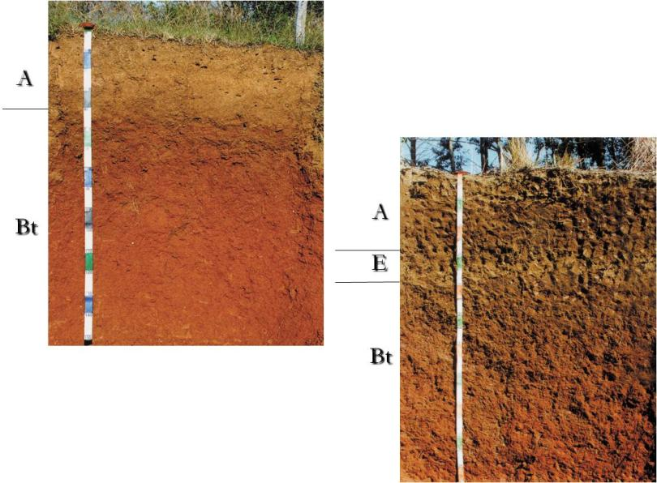{fig-align="center"}

:::

:::

## Horizonte B textural

Deve satisfazer pelo menos uma das condições:

::: {.incremental}

- Possuir um horizonte E no *sequum*, acima do B, desde que esse não seja plânico, plíntico ou espódico; ou
- Mudança textural abrupta; ou
- Possuir relação textural B/A que satisfaça uma das alternativas a seguir:
  - Relação B/A maior que 1,5 para solos com mais de 40% de argila no A ou E;
  - Relação B/A maior que 1,7 para solos com 15 a 40% de argila no A ou E;
  - Relação B/A maior que 1,8 para solos com menos de 15% de argila no A ou E.

:::

## Horizonte B latossólico

Horizonte em **avançado estágio de intemperização**, com praticamente ausência de minerais alteráveis, intensa dessilicificação e lixiviação de bases, com concentração residual de oxidróxidos de Fe e Al e argilominerais do tipo 1:1.

::: {.columns}

::: {.column style="font-size:24px"}

::: {.incremental}

- Baixa relação textural;
- Pouca diferenciação de cor entre os horizontes;
- Menos de 5% do volume com fragmentos de rochas;
- Grau de floculação (GF) da argila igual ou próximo de 100%;
- Menos de 4% de minerais primários alteráveis;
- CTC~pH7~ < 17 cmol~c~ kg^-1^ de argila;
- Cerosidade no máximo pouca e fraca.

:::

:::

::: {.column}

::: {layout-nrow=1}

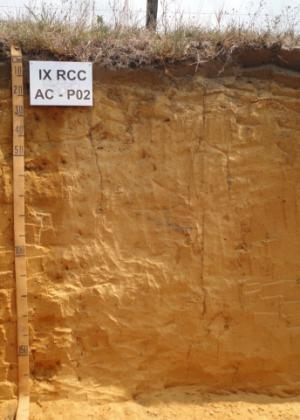{fig-align="center"}

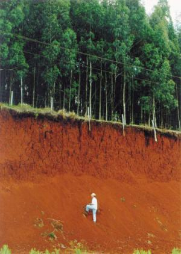{fig-align="center"}

:::

:::

:::

## Horizonte B incipiente

::: {.columns}

::: {.column style="font-size:24px"}

Horizonte que apresenta pouca alteração física e/ou química, porém o suficiente para desenvolvimento de um horizonte B com cor e estrutura.

::: {.incremental}

- 4% ou mais de minerais alteráveis na fração areia;
- 5% ou mais do volume do B com estrutura da rocha original;
- Relação molecular SiO~2~/Al~2~O~3~ (Ki) na fração argila maior do que 2,2;
- CTC da argila ≥ 17 cmol~c~ kg^-1^ de argila.

:::

:::

::: {.column}

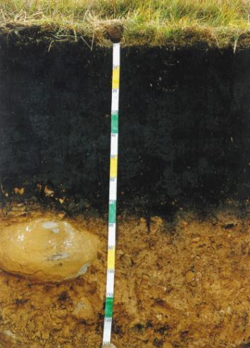{fig-align="center"}

:::

:::

## Horizonte B nítico

::: {.columns}

::: {.column}

Horizonte de textura argilosa ou muito argilosa, cujo incremento no conteúdo de argila é insuficiente para caracterizar um B textural.

::: {.fragment}

Apresenta cerosidade de quantidade e grau expressivos, daí a denominação **nítico** (= nítido, reluzente).

:::

:::

::: {.column}

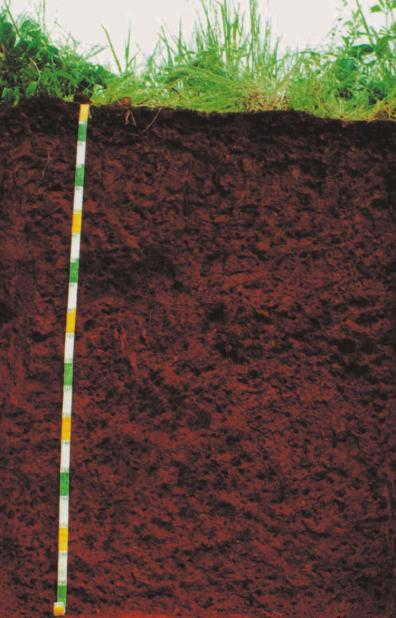{fig-align="center"}

:::

:::

## Horizonte B espódico

::: {.columns}

::: {.column}

Horizonte no qual houve **acumulação iluvial de matéria orgânica**, associada a complexos de sílica-Al ou húmus-Al.

:::

::: {.column}

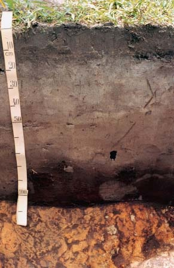{fig-align="center"}

:::

:::

## Horizonte B plânico

::: {.columns}

::: {.column}

Tipo especial de horizonte B textural, precedido de mudança textural abrupta.

Cores geralmente cinzentas ou cinzento-escuras, resultantes de processos de redução.

:::

::: {.column}

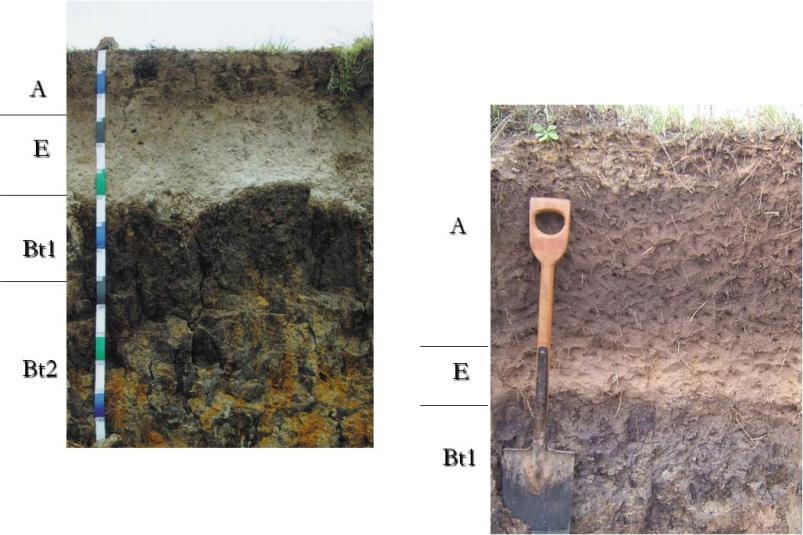{fig-align="center"}

:::

:::

## Horizonte plíntico

Horizonte mineral B e/ou C que apresenta um arranjamento de cores vermelhas e acinzentadas ou brancas, com ou sem cores amareladas ou brunadas, formando um padrão reticulado, poligonal ou laminar.

::: {.fragment}

Caracteriza-se pela presença de **plintita em quantidade igual ou superior a 15%** e **espessura de pelo menos 15 cm**.

:::

## Horizonte plíntico

::: {layout-nrow=1}

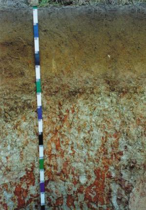{fig-align="center" height="450px"}

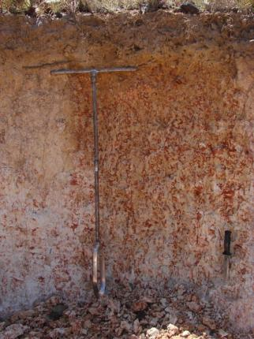{fig-align="center" height="450px"}

:::

## Horizonte glei

::: {.columns}

::: {.column}

Horizonte onde predominam reações de redução, formando horizonte com predomínio de cores acinzentadas claras ou escuras, com ou sem mosqueados.

Pode ser um horizonte C, B, E ou A e deve possuir menos do que 15% de plintita.

:::

::: {.column}

::: {layout-nrow=1}

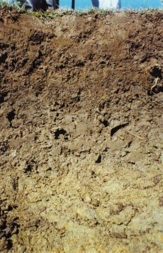{fig-align="center"}

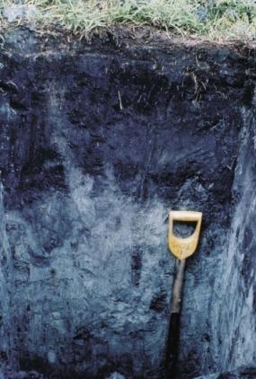{fig-align="center"}

:::

:::

:::

## Horizonte vértico

::: {.columns}

::: {.column style="font-size:24px"}

Horizonte que apresenta superfícies de fricção (*slickensides*) e fendas.

::: {.incremental}

- Horizontes coincidentes: B (Bi ou Bt) ou C;
- Possui pelo menos 300 g kg^-1^ de argila;
- Predominam argilominerais do tipo 2:1 expansíveis do grupo das esmectitas, tendo por isso CTC muito elevada.

:::

:::

::: {.column}

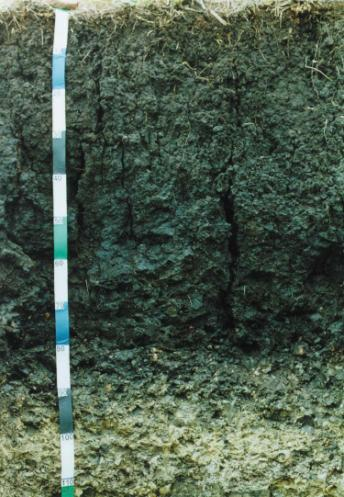{fig-align="center"}

:::

:::

## Horizonte E álbico

Horizonte subsuperficial no qual ocorreu perda ou segregação de material coloidal orgânico e inorgânico.

A cor do horizonte é clara, sendo determinada pela cor das partículas primárias de areia e silte.

Apresenta no mínimo 1 cm de espessura e requisitos de cores descritos no SiBCS.

## Horizonte cálcico e petrocálcico

[__Horizonte cálcico__]{.fg style="--col: #e64173"}

Horizonte de acumulação de carbonato de cálcio. Geralmente a acumulação ocorre no horizonte C, mas pode ocorrer no A e no B.

::: {.fragment}

[__Horizonte petrocálcico__]{.fg style="--col: #e64173"}

Horizonte resultante da consolidação do horizonte cálcico.

:::

## Etapas da classificação

::: {.incremental}

- Importância em classificar o solo;
- Classificação do solo:
  - Atributos diagnósticos;
  - Horizontes diagnósticos;
  - *Ordens de solos;

:::

## Leitura obrigatória

- Sistema Brasileiro de Classificação de Solos (SiBCS) – 2025;

{fig-align="center"}

## Atividade 

- Identificar as características ambientais;
- Identificar as características morfológicas;
- Classificar o horizonte superficial;
- Classificar o horizonte subsuperficial.

# Obrigado pela atenção

