# Classificação taxonômica do solo

## Classificação taxonômica do solo

::: {.incremental}

- Atributos diagnósticos;
- Horizontes diagnósticos;
- Ordens de solos.

:::

## Material de consulta

::: {layout-nrow=1}

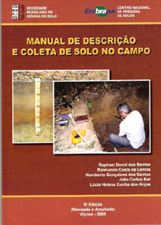{fig-align="center" height="500px"}

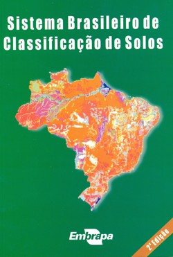{fig-align="center" height="500px"}

:::

# Conceitos de classificação

## O que é classificar?

[__Classificação__]{.fg style="--col: #e64173"}

Recurso utilizado para estudo pormenorizado de um objeto: seres vivos, compostos químicos, solos.

## Objetivos da classificação

::: {.incremental}

- Organização dos conhecimentos sobre um objeto ou tema;
- Estabelecimento de uma linguagem básica para a comunicação;
- Síntese e compreensão sobre semelhanças e diferenças entre indivíduos de uma população;
- Memorização das características de cada classe;
- Possibilidade de execução de estudos detalhados sobre uma ou mais classes.

:::

## População

Conjunto de indivíduos, de tamanho variável, de grande heterogeneidade em relação a uma série de características ou atributos.

::: {.fragment}

O agrupamento de indivíduos semelhantes, em relação a determinadas características, consiste na formação de **classes**.

:::

## Classificação e características diferenciais

[__Classificação:__]{.fg style="--col: #e64173"} inclusão de cada indivíduo em uma das classes formadas.

[__Características diferenciais (diagnósticas):__]{.fg style="--col: #e64173"} são os critérios utilizados para a diferenciação entre os indivíduos de uma população.

::: {.fragment}

Qual a característica diferencial utilizada: cor, forma ou tamanho?

[quadriláteros]{.fg style="--col: #e64173"} · [círculos]{.fg style="--col: #e64173"} · [triângulos]{.fg style="--col: #e64173"}

:::

## Níveis categóricos

[__Nosso caso: objeto "solos"__]{.fg style="--col: #e64173"}

::: {.incremental}

- Nível 1: solos argilosos;
- Nível 2: solos argilosos vermelhos;
- Nível 3: solos argilosos vermelhos distróficos.

:::

::: {.fragment}

Níveis categóricos inferiores: maior número de informações, maior homogeneidade e maior número de classes.

:::

## Tipos de classificação

A classificação é uma concepção da mente humana, com critérios arbitrários definidos em função de objetivos diferenciados.

::: {.fragment}

- Classificações naturais ou taxonômicas;
- Classificações técnicas ou interpretativas.

:::

## Classificações naturais ou taxonômicas

Utilizam ampla gama de características diferenciais.

[__Objetivos:__]{.fg style="--col: #e64173"}

::: {.incremental}

- Identificação de indivíduos e generalização de comportamento;
- Organização do conhecimento;
- Uniformização de terminologia;
- Possibilidade de extrapolação de resultados de pesquisa e experimentação (transferência de tecnologia).

:::

::: {.fragment}

[__Exemplos:__]{.fg style="--col: #e64173"} SiBCS; *Soil Taxonomy* (EUA); *Soil Map of the World* (FAO).

:::

## Classificações técnicas ou interpretativas

Seleção de características diferenciais específicas.

[__Objetivos:__]{.fg style="--col: #e64173"}

::: {.incremental}

- Definição do comportamento do solo;
- Definição do potencial e das limitações para um determinado uso do solo.

:::

::: {.fragment}

[__Exemplos:__]{.fg style="--col: #e64173"} Classificação da Capacidade de Uso das Terras; Sistema de Avaliação da Aptidão Agrícola das Terras; Sistema de Avaliação de Terras para Irrigação.

:::

# Sistema Brasileiro de Classificação de Solos

## Histórico do SiBCS (1/3)

::: {style="font-size:26px"}

::: {.incremental}

- **Década de 50:** utilização de classificação com base no antigo Sistema Americano;
- **Década de 60:** adaptação da definição dos horizontes diagnósticos, com base nos solos do Levantamento Pedológico do Estado de São Paulo;
- **Décadas de 60 a 80:** estabelecimento de classes em primeiro e segundo níveis, com base em solos levantados e descritos em diversas regiões do país;
- **1978:** primeira reunião de correlação, classificação e aplicação em levantamentos de solos (RCC, RJ).

:::

:::

## Histórico do SiBCS (2/3)

::: {style="font-size:26px"}

::: {.incremental}

- **1980:** 1ª aproximação: estrutura, atributos, horizontes, classes;
- **1981:** 2ª aproximação: inclui a definição do primeiro nível categórico;
- **1982:** II RCC (RJ, SP, MG);
- **1985:** III RCC (RJ, SP, MG, PR);
- **1987:** Boletim sobre a classificação de solos usada em levantamentos no Brasil (Camargo, Klamt & Kaufman);
- **1988:** 3ª aproximação: definição das classes;
- **1994:** IV RCC (RJ, ES, BA);
- **1995:** projeto EMBRAPA-CNPS: desenvolvimento do SiBCS em três instâncias (grupos locais, regionais e nacional).

:::

:::

## Histórico do SiBCS (3/3)

::: {style="font-size:26px"}

::: {.incremental}

- **1997:** 4ª aproximação;
- **1998:** V RCC (PE, PB, RN, CE, BA);
- **1999:** lançamento do SiBCS, 1ª edição;
- **2000:** VI RCC (sul do país);
- **2003:** XXIX CBCS: propostas de alterações no sistema;
- **2005:** XXX CBCS: propostas de atualização (alterações em ordens e subordens; maiores alterações em grandes grupos e subgrupos) e VII RCC (MG);
- **2006:** 2ª edição;
- **2013:** 3ª edição.
- **2014:** 4ª edição (E-book).
- **2018:** 5ª edição.
- **2025:** 6ª edição (publicação digital).

:::

:::

# Descrição de perfil do solo

## Exemplo: descrição geral

::: {style="font-size:22px"}

::: {.columns}

::: {.column}

- **Projeto/Perfil:** BR158 P1;
- **Data:** 25/10/2006;
- **Classificação:** Latossolo Amarelo Ácrico típico (LAw);
- **Localização:** 337588 / 9914948;
- **Situação e declive:** topo, 4%;
- **Altitude:** 84 metros;
- **Formação geológica:** Formação Barreiras;
- **Material de origem:** produtos da decomposição de arenito grosseiro.

:::

::: {.column}

- **Relevo local:** suave ondulado;
- **Relevo regional:** plano a suave ondulado;
- **Erosão:** laminar ligeira;
- **Drenagem:** fortemente drenado;
- **Vegetação:** floresta ombrófila densa;
- **Pedregosidade e rochosidade:** não pedregosa e não rochosa;
- **Uso atual:** floresta;
- **Descrito e coletado por:** Emil Cioran.

:::

:::

:::

## Exemplo: descrição morfológica

::: {style="font-size:17px"}

**A** (0-35 cm): bruno (10 YR 4/3, úmido); franco arenosa; muito fraca pequena granular e grãos simples; macio, muito friável, ligeiramente plástica e ligeiramente pegajosa; transição gradual e plana.

**Bw1** (35-61 cm): bruno-amarelado (10 YR 5/5, úmido); franco arenosa; maciça porosa que se desfaz em fraca pequena granular e grãos simples; ligeiramente dura, muito friável, ligeiramente plástica e ligeiramente pegajosa; transição difusa e plana.

**Bw2** (61-91 cm): bruno-amarelado (10 YR 5/7, úmido); franco argilo arenosa; maciça porosa que se desfaz em fraca pequena granular e média blocos subangulares; ligeiramente dura, muito friável, ligeiramente plástica e ligeiramente pegajosa; transição difusa e plana.

**Bt** (91-135 cm+): bruno-amarelado a amarelo-brunado (10 YR 5,5/8, úmido); franco argilo arenosa a argilo arenosa; moderada média blocos subangulares; cerosidade moderada; ligeiramente dura, muito friável, ligeiramente plástica e ligeiramente pegajosa; transição difusa e plana.

**Raízes:** muitas no A e Bw1, comuns no Bw2 e poucas no Bt.

:::

## Exemplo: análises químicas e físicas

::: {style="font-size:18px"}

| Hz. | Prof. (cm) | Calhau | Cascalho | Terra fina | Areia grossa | Areia fina | Silte | Argila | Argila natural | GF | Silte/Argila | C~org~ | N | C/N |
|:--:|:--:|:--:|:--:|:--:|:--:|:--:|:--:|:--:|:--:|:--:|:--:|:--:|:--:|:--:|
|     |        | % | % | % | % | % | % | % | % | % |      | % | % |    |
| A   | 0-35   | 0 | 2 | 98 | 61 | 16 | 7 | 16 | 5 | 69  | 0,44 | 0,97 | 0,06 | 16 |
| Bw1 | -61    | 0 | 3 | 97 | 66 | 15 | 5 | 14 | 6 | 45  | 0,45 | 0,66 | 0,04 | 16 |
| Bw2 | -91    | 0 | 7 | 93 | 60 | 14 | 5 | 21 | 8 | 62  | 0,24 | 0,33 | 0,02 | 16 |
| Bt  | -135+  | 0 | 5 | 95 | 53 | 16 | 4 | 27 | 0 | 100 | 0,15 | 0,20 | 0,02 | 10 |

:::

::: {style="font-size:18px"}

| Hz. | Prof. (cm) | pH H~2~O | pH KCl | Al | Ca | Mg | Na | K | H | H+Al | P (mg g^-1^) | S | T | V (%) | m (%) |
|:--:|:--:|:--:|:--:|:--:|:--:|:--:|:--:|:--:|:--:|:--:|:--:|:--:|:--:|:--:|:--:|
| A   | 0-35  | 4,0 | 4,1 | 1,0 | 0,1 | 0,1 | 0,01 | 0,03 | 3,0 | 4,0 | 2,8 | 0,2 | 4,2 | 5  | 83 |
| Bw1 | -61   | 4,4 | 4,3 | 1,1 | 0,1 | 0,1 | 0,01 | 0,01 | 3,2 | 4,3 | 1,5 | 0,2 | 4,5 | 4  | 85 |
| Bw2 | -91   | 4,4 | 4,3 | 0,7 | 0,1 | 0,1 | 0,01 | 0,01 | 3,6 | 4,3 | 0,8 | 0,2 | 4,5 | 4  | 78 |
| Bt  | -135+ | 4,4 | 4,3 | 0,6 | 0,1 | 0,1 | 0,01 | 0,00 | 0,2 | 0,8 | 0,7 | 0,2 | 1,0 | 20 | 75 |

Al, Ca, Mg, Na, K, H, H+Al, S e T em cmol~c~ kg^-1^.

:::

# Ordens de solos

## Níveis categóricos do SiBCS

::: {style="font-size:20px"}

| Nível | Categoria | Critério |
|:--|:--|:--|
| 1º | **Ordens** | Presença ou ausência de atributos, horizontes ou propriedades identificadas no campo; atuação de processos na formação do solo. |
| 2º | **Subordens** | Atuação de outros processos que agem junto com os processos dominantes; envolve propriedades relacionadas ao desenvolvimento das plantas. |
| 3º | **Grandes grupos** | Tipo e arranjamento de horizontes; atividade da argila; saturação por bases, Al ou Na; presença de propriedades que restringem o desenvolvimento das plantas. |
| 4º | **Subgrupos** | Típico; intermediário para o 1º, 2º ou 3º nível; características extraordinárias. |
| 5º | **Famílias** | Não aparecem no SiBCS. |
| 6º | **Séries** | Não aparecem no SiBCS. |

:::

## 1º nível categórico: Ordens

[__Presença ou ausência de atributos, horizontes ou propriedades identificadas no campo.__]{.fg style="--col: #e64173"} Atuação de processos na formação do solo.

::: {.columns}

::: {.column}

- Organossolos
- Neossolos
- Vertissolos
- Espodossolos
- Planossolos
- Gleissolos
- Latossolos

:::

::: {.column}

- Chernossolos
- Cambissolos
- Plintossolos
- Luvissolos
- Nitossolos
- Argissolos

:::

:::

## Ordens

<iframe 
  src="../../Sistema-Brasileiro-de-Classificacao-de-Solos-2025.pdf"
  width="100%"
  height="650px">
</iframe>

# As 13 ordens de solos

## Organossolos

::: {.columns}

::: {.column}

[__Origem:__]{.fg style="--col: #e64173"} grego *organikós*, pertinente ou próprio dos compostos de carbono. Conotativo de solos de constituição orgânica, em ambientes de grande umidade.

[__No SiBCS:__]{.fg style="--col: #e64173"} solos constituídos por material orgânico (C-org ≥ 80 g kg^-1^ de TFSA), que apresentam horizonte hístico.

::: {.fragment}

**Diagnóstico:** presença de horizonte H ou O.

:::

:::

::: {.column}

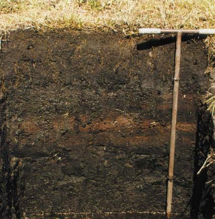{fig-align="center" height="480px"}

:::

:::

## Organossolos

::: {layout-nrow=1}

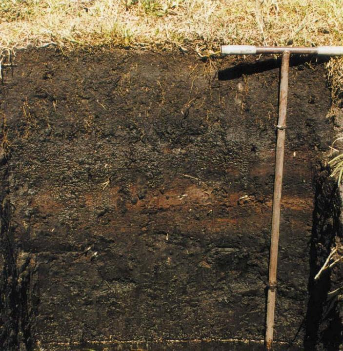{fig-align="center" height="450px"}

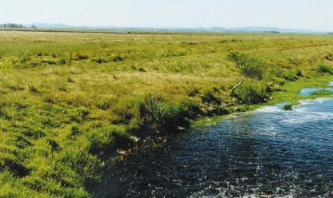{fig-align="center" height="300px"}

:::

::: {.fragment}

Atenção a: presença de materiais sulfídricos; densidade do solo.

:::

## Organossolos

::: {layout-nrow=1}

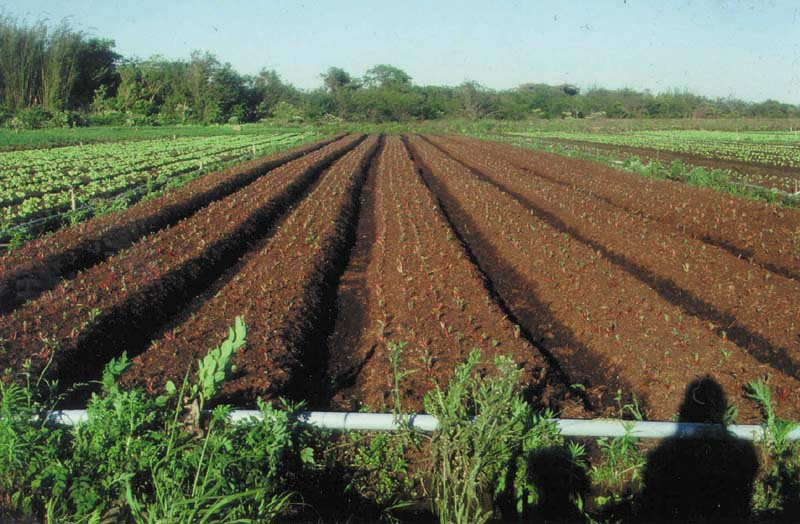{fig-align="center" height="400px"}

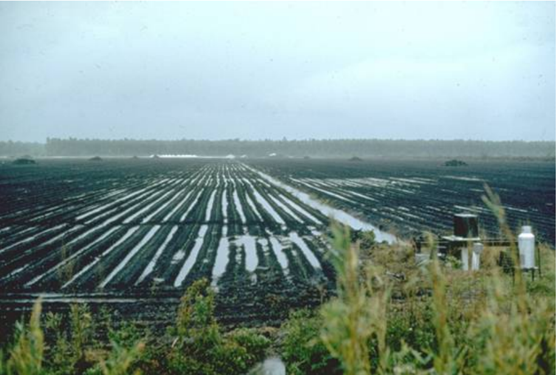{fig-align="center" height="400px"}

:::

## Neossolos

[__Origem:__]{.fg style="--col: #e64173"} grego *néos*, novo, moderno. Conotativo de solos jovens, em início de formação, com pequeno desenvolvimento.

[__No SiBCS:__]{.fg style="--col: #e64173"} solos pouco evoluídos.

::: {.fragment}

**Diagnóstico:** sem presença de horizonte subsuperficial.

:::

## Neossolos

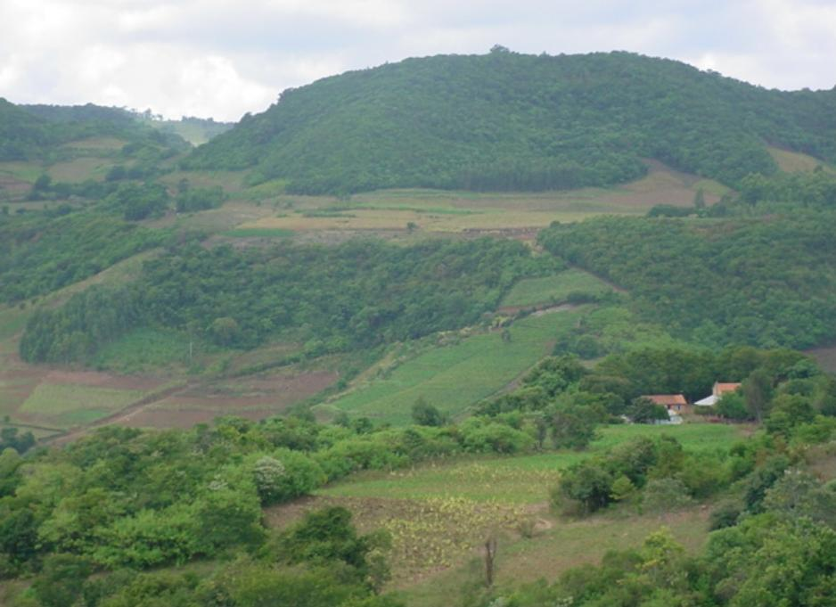{fig-align="center" height="500px"}

## Neossolo Litólico Eutrófico chernossólico

::: {layout-nrow=1}

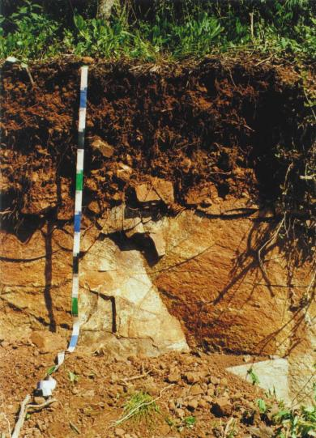{fig-align="center" height="480px"}

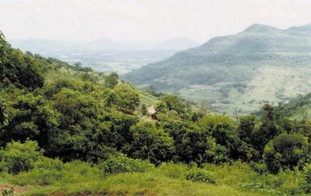{fig-align="center" height="300px"}

:::

## Neossolo Litólico Distrófico típico

::: {layout-nrow=1}

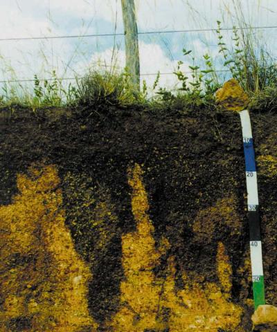{fig-align="center" height="480px"}

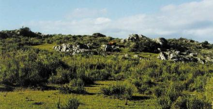{fig-align="center" height="280px"}

:::

## Neossolo Quartzarênico Órtico típico

::: {layout-nrow=1}

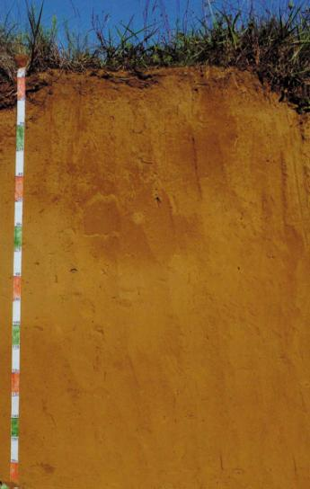{fig-align="center" height="480px"}

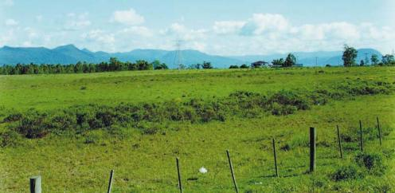{fig-align="center" height="280px"}

:::

## Neossolos

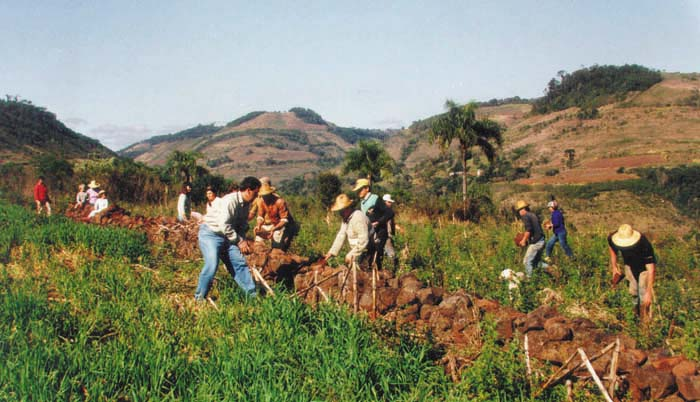{fig-align="center" height="500px"}

## Vertissolos

[__Origem:__]{.fg style="--col: #e64173"} latim *vertere*. Conotativo de movimento na superfície do solo (expansão/contração).

[__No SiBCS:__]{.fg style="--col: #e64173"} solos constituídos por material mineral com horizonte vértico entre 25 e 100 cm de profundidade e relação textural insuficiente para caracterizar um B textural.

::: {.fragment}

**Diagnóstico:** presença de minerais 2:1 expansíveis.

:::

## Vertissolo Ebânico Órtico chernossólico

::: {layout-nrow=1}

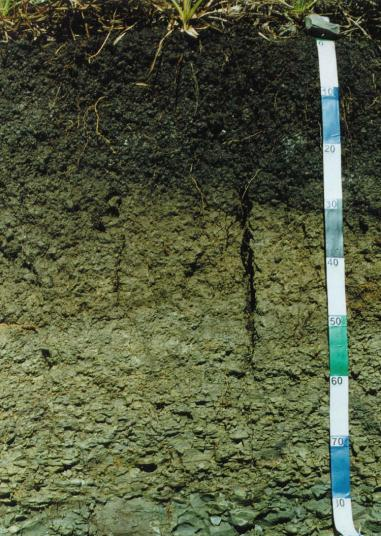{fig-align="center" height="480px"}

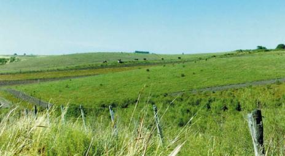{fig-align="center" height="280px"}

:::

## Vertissolos: manejo

::: {.columns}

::: {.column}

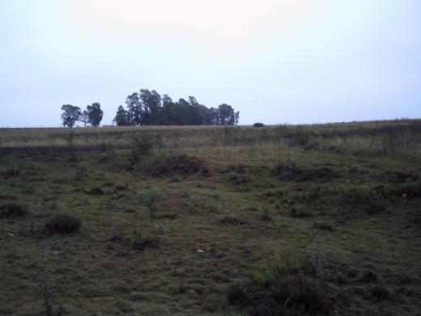{fig-align="center" height="300px"}

- Condições químicas;
- Manejo do solo.

:::

::: {.column}

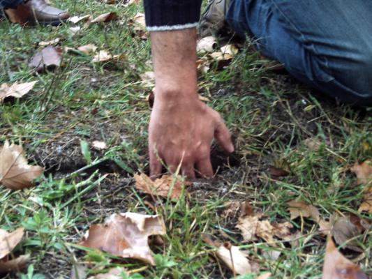{fig-align="center" height="300px"}

- Condições físicas;
- Erosão do solo.

:::

:::

## Espodossolos

[__Origem:__]{.fg style="--col: #e64173"} grego *spodos*, cinza vegetal. Solos com horizonte de acumulação de materiais orgânicos e outros.

[__No SiBCS:__]{.fg style="--col: #e64173"} solos constituídos por material mineral, com horizonte B espódico imediatamente abaixo de horizonte E ou A, dentro de 200 cm da superfície, ou de 400 cm de profundidade se a soma A+E ultrapassar 200 cm.

::: {.fragment}

**Diagnóstico:** horizonte "escuro" em subsuperfície.

:::

## Espodossolos

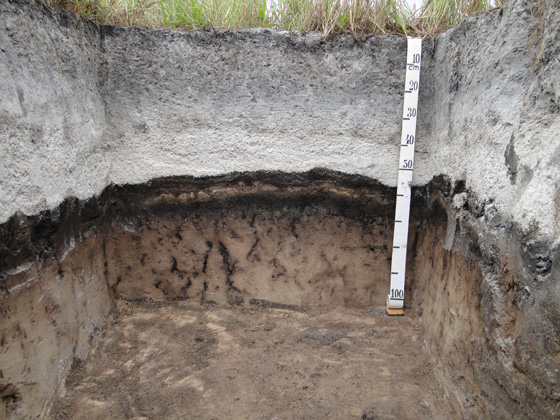{fig-align="center" height="500px"}

## Planossolos

[__Origem:__]{.fg style="--col: #e64173"} latim *planus*, plano, horizontal. Conotativo de solos desenvolvidos com encharcamento superficial estacional.

[__No SiBCS:__]{.fg style="--col: #e64173"} solos constituídos por material mineral com horizonte A ou E seguido de horizonte B plânico.

::: {.fragment}

**Diagnóstico:** transição abrupta de horizonte.

:::

## Planossolos

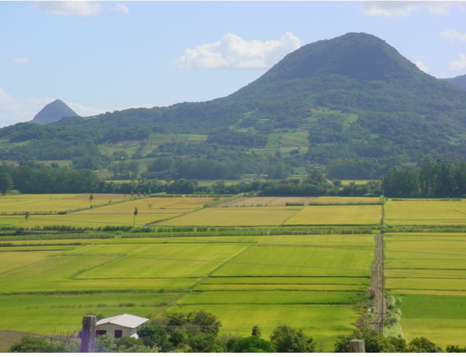{fig-align="center" height="500px"}

## Planossolo Hidromórfico Eutrófico arênico

::: {layout-nrow=1}

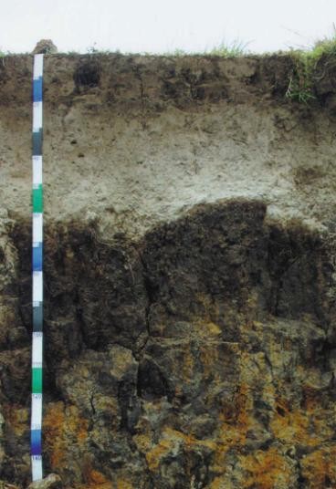{fig-align="center" height="480px"}

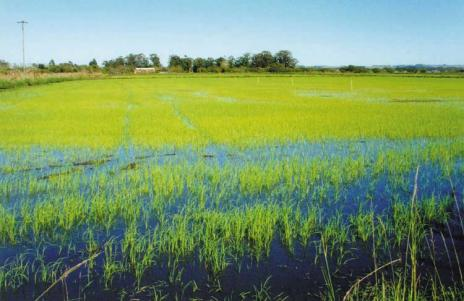{fig-align="center" height="300px"}

:::

## Planossolo Hidromórfico Eutrófico solódico

::: {layout-nrow=1}

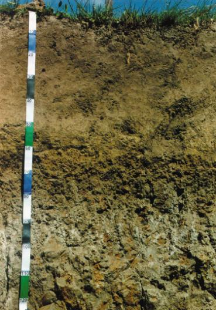{fig-align="center" height="480px"}

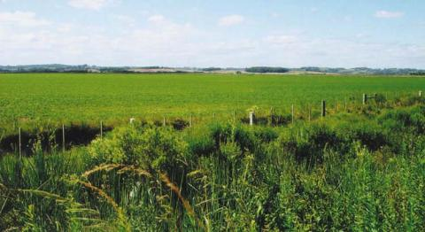{fig-align="center" height="280px"}

:::

## Gleissolos

[__Origem:__]{.fg style="--col: #e64173"} russo *gley*, massa de solo pastosa. Conotativo de excesso de água.

[__No SiBCS:__]{.fg style="--col: #e64173"} solos com horizonte glei imediatamente abaixo de um horizonte A.

::: {.fragment}

**Diagnóstico:** sem transição abrupta entre horizontes.

:::

## Gleissolo Melânico Eutrófico típico

::: {layout-nrow=1}

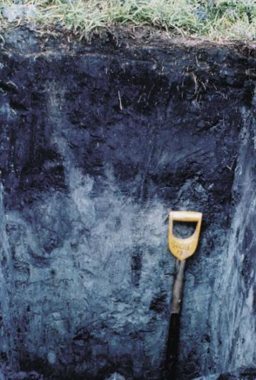{fig-align="center" height="480px"}

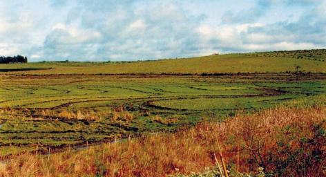{fig-align="center" height="280px"}

:::

## Latossolos

[__Origem:__]{.fg style="--col: #e64173"} latim *later*, material altamente alterado (tijolo). Conotativo de elevado conteúdo de sesquióxidos.

[__No SiBCS:__]{.fg style="--col: #e64173"} solos constituídos por material mineral, com horizonte B latossólico imediatamente abaixo de qualquer tipo de horizonte A, dentro de 200 cm da superfície ou de 300 cm se o horizonte A tiver mais de 150 cm de espessura.

::: {.fragment}

**Diagnóstico:** solos profundos, avermelhados ou amarelados.

:::

## Latossolo Vermelho Aluminoférrico típico

::: {layout-nrow=1}

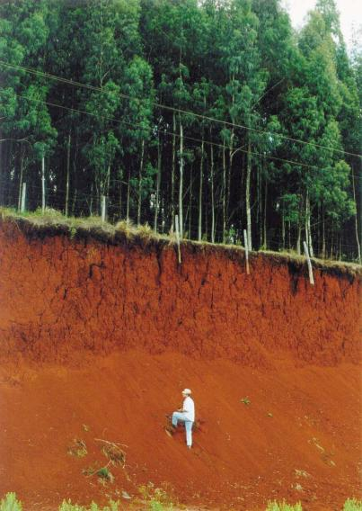{fig-align="center" height="480px"}

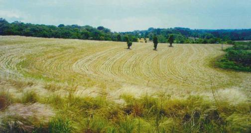{fig-align="center" height="280px"}

:::

## Latossolo Bruno Alumínico câmbico

::: {layout-nrow=1}

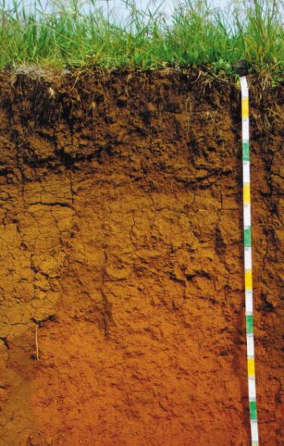{fig-align="center" height="480px"}

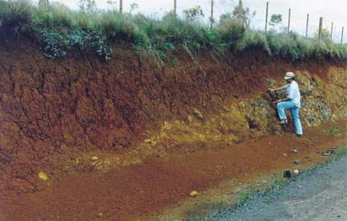{fig-align="center" height="230px"}

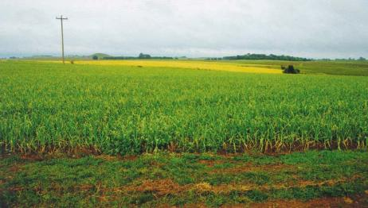{fig-align="center" height="230px"}

:::

## Latossolo Vermelho Distroférrico típico

::: {layout-nrow=1}

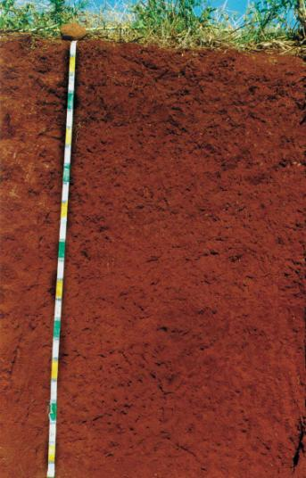{fig-align="center" height="480px"}

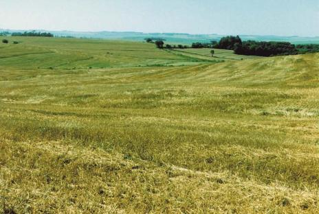{fig-align="center" height="280px"}

:::

## Latossolo Vermelho Distrófico típico

::: {layout-nrow=1}

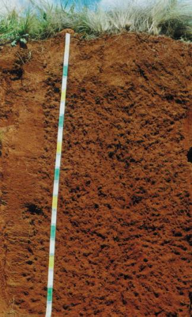{fig-align="center" height="480px"}

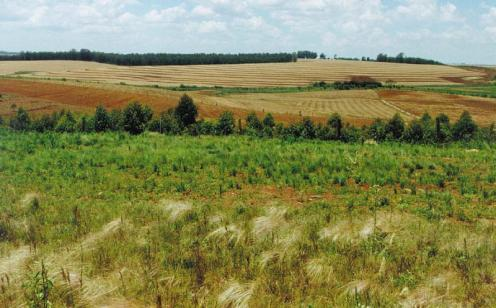{fig-align="center" height="300px"}

:::

## Latossolos

::: {layout-nrow=1}

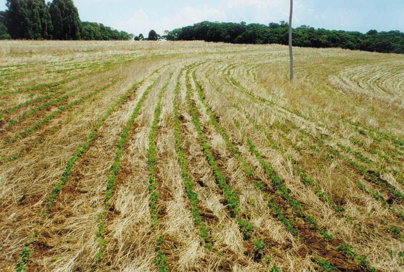{fig-align="center" height="400px"}

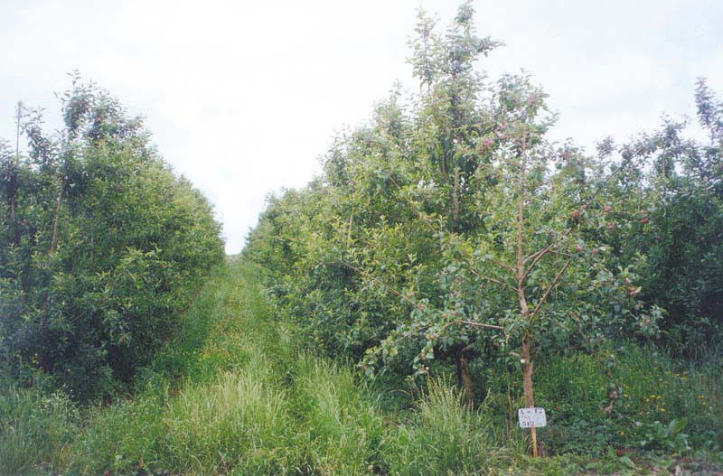{fig-align="center" height="400px"}

:::

## Chernossolos

[__Origem:__]{.fg style="--col: #e64173"} russo *chern*, negro. Conotativo de solos ricos em matéria orgânica, de coloração escura (A chernozêmico): preto e rico em bases.

[__No SiBCS:__]{.fg style="--col: #e64173"} solos constituídos por material mineral que apresentam horizonte A chernozêmico.

::: {.fragment}

**Diagnóstico:** características químicas (alta saturação por bases).

:::

## Chernossolos

**Alta saturação por bases** e **horizonte A chernozêmico**.

::: {layout-nrow=1}

{fig-align="center" height="320px"}

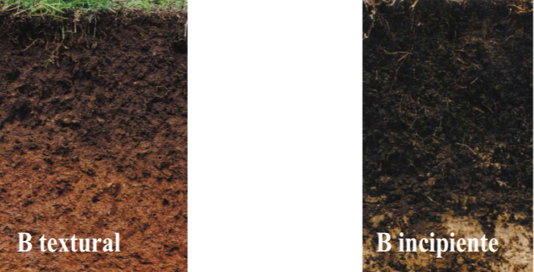{fig-align="center" height="320px"}

:::

## Chernossolo Ebânico Carbonático vértico

::: {layout-nrow=1}

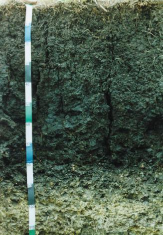{fig-align="center" height="480px"}

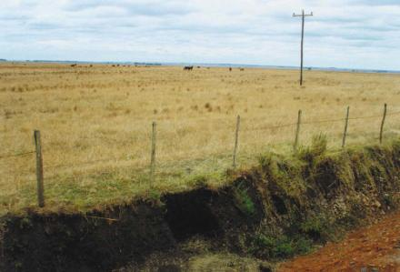{fig-align="center" height="280px"}

:::

## Chernossolo Argilúvico Férrico típico

::: {layout-nrow=1}

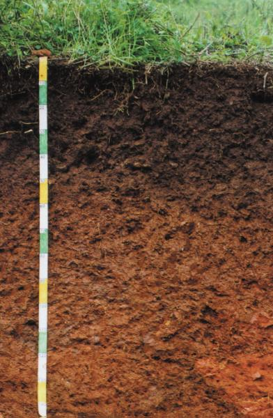{fig-align="center" height="480px"}

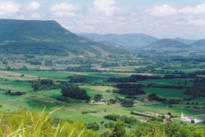{fig-align="center" height="230px"}

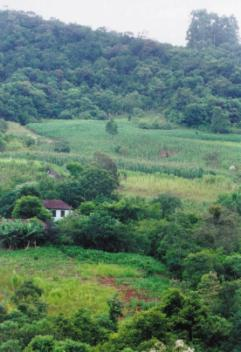{fig-align="center" height="300px"}

:::

## Cambissolos

[__Origem:__]{.fg style="--col: #e64173"} latim *cambiare*, trocar. Conotativo de solos em formação (transformação).

[__No SiBCS:__]{.fg style="--col: #e64173"} solos constituídos por material mineral com horizonte B incipiente subjacente a qualquer tipo de horizonte superficial, exceto hístico com 40 cm ou mais de espessura, ou horizonte A chernozêmico quando o B incipiente apresentar argila de atividade alta e saturação por bases alta.

::: {.fragment}

Plintita e petroplintita, horizonte glei e horizonte vértico, se presentes, não satisfazem os requisitos para Plintossolos, Gleissolos e Vertissolos, respectivamente.

:::

## Cambissolo Húmico Alumínico típico

::: {layout-nrow=1}

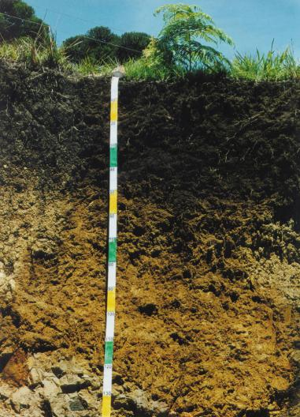{fig-align="center" height="480px"}

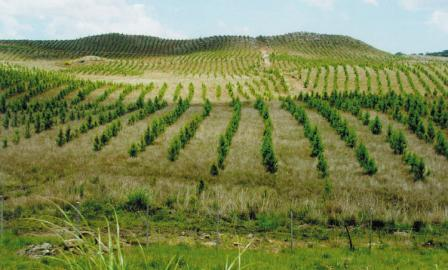{fig-align="center" height="230px"}

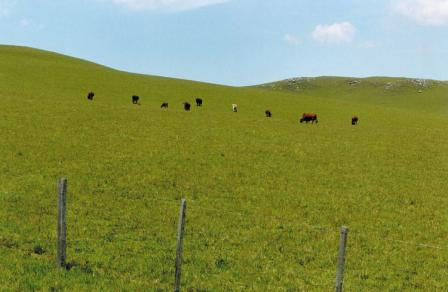{fig-align="center" height="230px"}

:::

## Cambissolo Háplico Tb Distrófico típico

::: {layout-nrow=1}

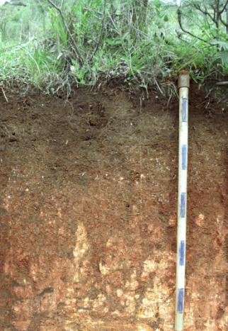{fig-align="center" height="480px"}

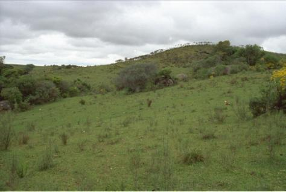{fig-align="center" height="300px"}

:::

## Cambissolo Háplico Ta Eutrófico típico

::: {layout-nrow=1}

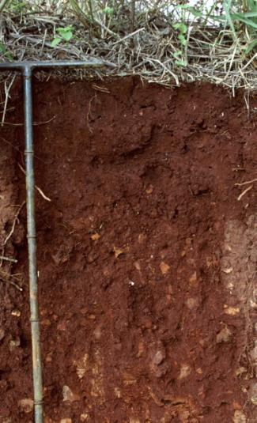{fig-align="center" height="480px"}

{fig-align="center" height="280px"}

:::

## Plintossolos

[__Origem:__]{.fg style="--col: #e64173"} grego *plinthos*, ladrilho. Conotativo de materiais argilosos, coloridos, que endurecem quando expostos.

[__No SiBCS:__]{.fg style="--col: #e64173"} solos constituídos por material mineral, apresentando horizonte plíntico, litoplíntico ou concrecionário.

::: {.fragment}

**Diagnóstico:** plintita ou petroplintita em volume suficiente ao requerido pelo sistema de classificação.

:::

## Plintossolo Argilúvico Eutrófico abrúptico

::: {layout-nrow=1}

{fig-align="center" height="480px"}

{fig-align="center" height="230px"}

{fig-align="center" height="230px"}

:::

## Luvissolos

[__Origem:__]{.fg style="--col: #e64173"} latim *luere*, lavar. Conotativo de acumulação de argila; solo saturado, com argila de atividade alta (Ta).

[__No SiBCS:__]{.fg style="--col: #e64173"} solos constituídos por material mineral, com argila de atividade alta, alta saturação por bases e horizonte B textural imediatamente abaixo de horizonte A fraco, moderado ou proeminente, ou horizonte E.

::: {.fragment}

"É um Argissolo com alta saturação por bases e argila de atividade alta (Ta)."

:::

## Luvissolo Crômico Órtico típico

::: {layout-nrow=1}

{fig-align="center" height="480px"}

{fig-align="center" height="280px"}

:::

## Nitossolos

[__Origem:__]{.fg style="--col: #e64173"} latim *nitidus*, brilhante. Conotativo de superfícies brilhantes em unidades estruturais.

[__No SiBCS:__]{.fg style="--col: #e64173"} solos com 350 g kg^-1^ ou mais de argila, constituídos por material mineral com horizonte B nítico imediatamente abaixo do horizonte A ou dentro dos primeiros 50 cm do horizonte B, com argila de atividade baixa ou caráter alítico na maior parte do B, dentro de 150 cm da superfície.

::: {.fragment}

**Diagnóstico:** presença de cerosidade.

:::

## Nitossolo Vermelho Distroférrico latossólico

::: {layout-nrow=1}

{fig-align="center" height="480px"}

{fig-align="center" height="280px"}

:::

## Argissolos

[__Origem:__]{.fg style="--col: #e64173"} latim *argilla*, conotando solos com processo de acumulação de argila.

[__No SiBCS:__]{.fg style="--col: #e64173"} solos constituídos por material mineral, com horizonte B textural imediatamente abaixo do A ou E, com argila de atividade baixa, ou com argila de atividade alta conjugada com saturação por bases baixa e/ou caráter alítico na maior parte do horizonte B.

::: {.fragment}

**Diagnóstico:** presença de B textural.

:::

## Argissolo Vermelho Distrófico latossólico

::: {layout-nrow=1}

{fig-align="center" height="480px"}

{fig-align="center" height="280px"}

:::

## Argissolo Vermelho-Amarelo Distrófico arênico

::: {layout-nrow=1}

{fig-align="center" height="480px"}

{fig-align="center" height="300px"}

:::

## Argissolo Vermelho-Amarelo Distrófico típico

::: {layout-nrow=1}

{fig-align="center" height="480px"}

{fig-align="center" height="300px"}

:::

## Argissolos

::: {layout-nrow=1}

{fig-align="center" height="280px"}

{fig-align="center" height="280px"}

{fig-align="center" height="280px"}

:::

## Classes de solo no Brasil

::: {style="font-size:24px"}

| Classes | Área absoluta (km^2^) | Área relativa (%) |
|:--|--:|--:|
| Latossolos   | 2.799.703 | 33,6 |
| Argissolos   | 2.390.473 | 28,7 |
| Neossolos    | 1.138.360 | 13,7 |
| Cambissolos  | 437.262   | 5,2  |
| Plintossolos | 426.482   | 5,1  |
| Gleissolos   | 369.119   | 4,4  |
| Luvissolos   | 238.480   | 2,9  |
| Planossolos  | 196.377   | 2,4  |
| Espodossolos | 144.686   | 1,7  |
| Nitossolos   | 111.058   | 1,3  |
| Chernossolos | 27.473    | 0,3  |
| Vertissolos  | 19.261    | 0,2  |
| Organossolos | 6.753     | 0,1  |
| Outros       | 25.328    | 0,3  |

:::

# Fim!

